<p align="center">
  <b>English</b> | <a href="README.md">简体中文</a>
</p>

<p align="center">
  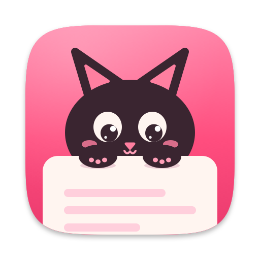
</p>

<h1 align="center">Kitty Tools</h1>

<p align="center">
  Native productivity tools, written separately for macOS and Windows: Clipboard History · Launcher · Translate · Screenshot · Screen and Audio Recording · Notes · Reminders · Launchpad · Status Screen · Dock Preview · Finder Menu · Notch · Keep Awake · Smooth Scrolling · App Shortcuts · Key Remapping · Bluetooth Sleep
</p>

<p align="center">
  
  
  
  
  
  <a href="https://yyadnbug.github.io/kitty-tools/en/download/"></a>
</p>

<p align="center">
  <a href="https://yyadnbug.github.io/kitty-tools/en/"><b>Website</b></a> ·
  <a href="https://yyadnbug.github.io/kitty-tools/en/download/">Download & Install</a> ·
  <a href="https://yyadnbug.github.io/kitty-tools/en/changelog/">Release Notes</a> ·
  <a href="https://yyadnbug.github.io/kitty-tools/en/faq/">FAQ</a>
</p>

<p align="center">
  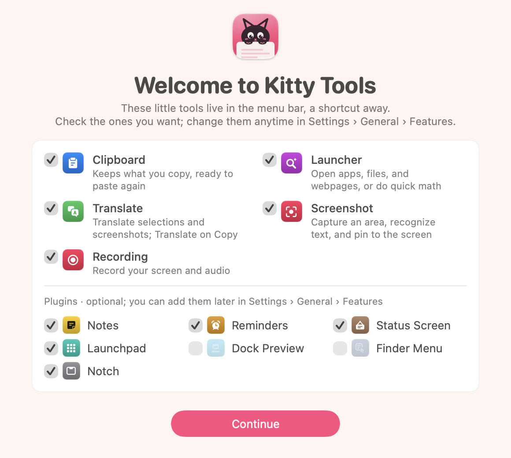
</p>

The macOS version is written in Swift 6 with SwiftUI and AppKit. It lives in the menu bar: click the menu bar icon to open Home, where every feature sits in its own tile (just start typing to search in the Launcher), or call any of them up with a global shortcut or from the Launcher. Panels don’t take focus from the app you’re using, so what you pick can be pasted straight back into it. There are five features—Clipboard, Launcher, Translate, Screenshot and Recording (new installs turn on the first four)—while Notes, Reminders, Status Screen, Launchpad, Dock Preview, Finder Menu, the Notch, Keep Awake, Bluetooth Sleep, Smooth Scrolling, App Shortcuts and Key Remapping are plugins: add them in Settings › Plugins when you want them, and until then they don’t appear or run. First-run setup lets you pick both. The interface is available in English and Simplified Chinese and follows the system language by default. Text recognition, language detection and sensitive-content detection all happen on your Mac, and keys are stored in the system keychain. Notices grow out of the notch at the top of the screen, settings and data are backed up every day, and everything can sync between Macs (through a folder on a synced drive or a WebDAV server). Light and dark appearance are supported and you can choose the accent color; from macOS 26 the app icon is a layered icon that follows the system icon style (Dark, Tinted, Clear). New versions install from inside the app in one click.

> A personal project, updated regularly. The macOS version runs on macOS 15 or later, with separate packages for Apple silicon and Intel (Intel from 0.10.0); the Windows version runs on Windows 11 22H2 or later (x64 / ARM64). The Windows version is currently in Chinese only.

## Branches

`main` holds only this introduction and its screenshots. The code is split by platform into two branches:

| Branch | Contents | Releases |
|---|---|---|
| [`macos`](https://github.com/YyAdnBug/kitty-tools/tree/macos) | macOS version (Swift 6 + SwiftUI / AppKit), zero third-party dependencies | tags `macos-v*`, the newest marked latest |
| [`windows`](https://github.com/YyAdnBug/kitty-tools/tree/windows) | Windows version (C# + .NET + WinUI 3, Native AOT), Microsoft packages only | tags `windows-v*`, not marked latest |

Both versions keep their features, look and defaults as close as they can. Snippets, the Word List, web searches, translation services, notes and reminders can sync between Mac and Windows.

## Windows version

It lives in the notification area, comes up with global shortcuts and follows the look of Windows 11 (acrylic, Segoe). Its features match the Mac version: Clipboard History (snippets, collections, pasting several items, dragging out), Translate (eight services, streaming, Translate Selection / Type to Translate / Translate on Copy, history and Word List), Launcher (apps, settings pages, system commands, calculator, file search, browser bookmarks, kill / port), Screenshot (annotation, text recognition, pinning, Translate Screenshot, Scrolling Capture, Screenshot History), screen and audio recording, Notes, Reminders and Status Screen, plus the Keep Awake plugin; screenshots can pick out elements like buttons and sidebars inside windows, sync can connect to a WebDAV server, and exported settings can be imported into the macOS version and vice versa.

In [Releases](https://github.com/YyAdnBug/kitty-tools/releases), find a version starting with `windows-v`, download `KittyTools-x.y.z-windows-x64-setup.exe` (the arm64 one for ARM PCs) and run it; after that it updates itself. The code, conventions and plans are under `windows/` on the [`windows`](https://github.com/YyAdnBug/kitty-tools/tree/windows/windows) branch, starting with `windows/AGENTS.md`.

## macOS features

Clipboard History, Launcher, Translate, Screenshot and Screen and Audio Recording are the features. Each can be turned off entirely in Settings › General › Features: its entry points, shortcuts and background work stop together, and its data and settings are kept.

### 📋 Clipboard History

<p align="center">
  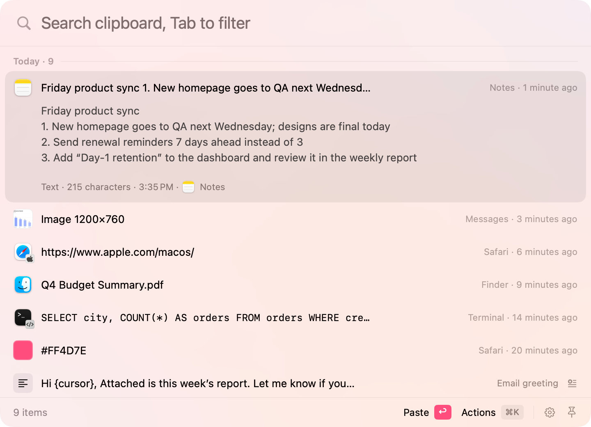
</p>

- Records the **text (with formatting, and text mixed with images pastes back with its images), images and files** you copy; copying something again just moves it to the top. Text synced over from other devices by remote-control tools or input methods is recorded too
- **Keyboard first**: ↩ pastes back into the app you were using, ⌥↩ pastes plain text, ⌘1–9 pastes the Nth item, select several to paste them together, and ⌘Z undoes deletions one after another
- **Lens preview**: the selected item expands in place—code and JSON get line numbers and syntax coloring, colors show HEX / RGB / HSL, links show their title and image; ⌘Y (or Space while the search field is empty) for a larger preview
- **Images you can see**: image items show as small pictures (you can see the top of long or phone screenshots) and grow in place when selected; turn this off in Settings if you prefer
- **Search**: text, text inside images (recognized on your Mac, no network), file paths, labels and source apps are all searchable; press Tab to filter by type, kind of content, source app or collection
- **Collections, snippets and labels**: favorites can go into several collections and any item can have a label; snippets support placeholders such as `{date}`, `{time}`, `{uuid}`, `{clipboard:N}` and `{cursor}`, dates and times can be offset and formatted (`{date+1d}`, `{date-1w:yyyy/MM/dd}`), and `{input:Name}` asks you to fill in a blank before pasting; favorites and snippets are never cleaned up automatically
- **Expand snippets by keyword**: give a snippet a keyword and typing it in any app replaces it with the snippet (`{cursor}` and `{input}` still work, and it works in Notes too); set it when creating a snippet, or choose Keyword… from ⌘K for an existing one. Needs Accessibility access; turn off “Expand snippets by keyword” in Settings › Clipboard if you don’t want it
- **Handy actions**: ⌘O opens a file and ⌘R shows it in Finder, ⌘T translates the selected item, images and text can be pinned to the screen, and items can be dragged straight into other apps
- **Where the panel appears**: at the top of the screen, at the pointer, or wherever you last dragged it; drag the left, right or bottom edge to resize
- **Privacy**: skips password managers and content marked private, lets you exclude apps and pause recording (the menu bar icon shows a pause badge), and automatically blocks sensitive text such as API keys, bearer tokens and bank card numbers; regular history is kept from 1 day to forever, image storage can be capped, and history can be cleared when you quit or lock the screen

### 🚀 Launcher

<p align="center">
  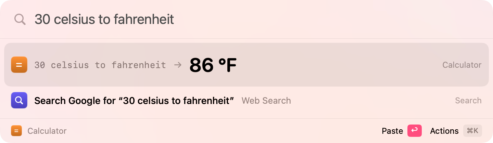
  <br><br>
  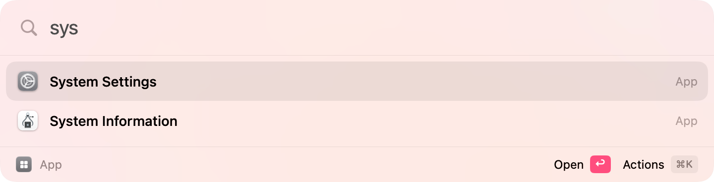
  <br><br>
  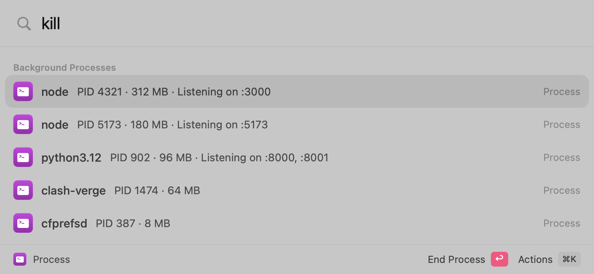
</p>

- **Find apps**: by English name, Chinese name, full pinyin or initials, ranked by how you use them (pick an app once for what you typed and it comes first next time); iPad apps are found too, and English and Chinese names both work whichever language the interface is in; ⌘D adds favorites, which come first when the field is empty
- **File search**: `open name` opens a file and `find name` selects it in Finder; ⌘Y for Quick Look, ⌘K to open it with another app or move it to the Trash; select several with ⇧↑↓ or ⌘-click (also when browsing folders), then press ↩ to open them all or ⌘↩ to show them in Finder; bring the Launcher back within 90 seconds of opening a file and you’re back at the same search and row
- **Browse folders**: type a path starting with `/` or `~` to list what’s in the folder, filtered by what you’ve typed so far; Tab goes into a folder, ⇧Tab goes up a level, ↩ opens. A file’s ⌘K menu can also open it in Terminal, copy the file, or copy its path in terminal form
- **Calculator and conversions**: arithmetic, percentages, powers and functions; units (`10 km to mi`, `30 c to f`), number bases (`255 in hex`) and currency (`100 usd`, fetched online, using the last saved rates when offline); ↩ pastes the result
- **Script Commands**: every script in your scripts folder is a command, with optional arguments (pop-up choices, passwords); results can be copied, pasted, shown in full (live as the script runs, with terminal colors) or listed as rows that open links and files. 8 come built in (Unix timestamps, Base64, URL encoding, JSON formatting, number bases, regex testing, UUIDs, toggling Dark Mode). Copy a script an AI wrote for you and click “New from Clipboard” to use it
- **Commands & Aliases**: change the keyword for any built-in command or script, turn off the ones you don’t use, and give each command its own shortcut; apps can have aliases too
- **System commands**: `lock`, `sleep`, `restart`, `emptytrash`, `mute` and more; `quit` / `hide` / `forcequit` manage running apps, `eject` ejects disks, `kill` ends processes or finds them by port (`kill :3000`), `port` shows which ports are in use and by whom (`port 3000`), and `ip` lists your local and public addresses
- **Shortcuts**: type the name of a shortcut from the Shortcuts app to run it
- **Search menu items**: with the App Shortcuts plugin added, search the frontmost app’s menu items (including ones without a shortcut) and press ↩ to switch back and run one
- **System Settings**: search “Bluetooth”, “Displays” or “Privacy & Security” and press ↩ to jump to that page
- **Web Search**: keywords like `g swift` and `gh swift` go straight to a site; 13 search engines come preset, including Google, Bing, GitHub and more, and you can add your own searches and Quicklinks
- **Browser bookmarks and history**: Safari, Chrome, Edge, Arc, Brave, Firefox and more—only the ones you have installed, with site icons; type a URL to open it directly
- `cb keyword` jumps to Clipboard History search, `fy text` translates right away, `remind me in 10 min to stretch` creates a reminder, and ⌘K or → opens the actions menu

### 🌐 Translate

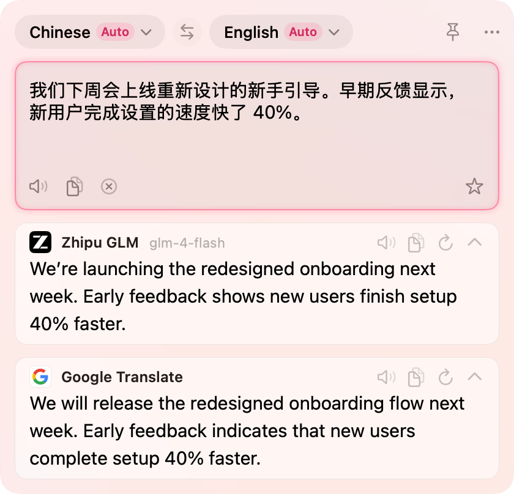

- **Translate Selection**: select text in any app and press the shortcut; the panel appears centered at the top of the screen (or at the pointer if you prefer). When the selection can’t be read directly it copies it with ⌘C and restores your clipboard afterwards
- **Type to Translate, Translate on Copy and Translate Screenshot**: select text on the screen, recognize it on your Mac and translate it; translations can also be placed back on the screenshot, with paragraphs that don’t fit moved to a card beside it
- **Several services at once**: Zhipu GLM (built in, ready to use), Apple Translation and Youdao Dictionary (no key needed), Baidu, Youdao, Google, DeepL / DeepLX, Microsoft (works without a key), Volcengine, Tencent, and large language models using the OpenAI, Azure OpenAI or Anthropic protocols; presets for DeepSeek, Kimi, Qwen, SiliconFlow, OpenRouter, Gemini, Ollama and others work once you add a key. Language model translations stream in as they’re generated. Free services are marked in Settings, and services you collapse translate only when you expand them, so they use no quota
- **Sentence explanations**: turn on “Explain foreign sentences” for a language model service, and when one foreign sentence is translated into your first language you get three to five key words and the sentence pattern along with the translation—handy for learning a language. Each language model service can also take extra instructions (such as “keep technical terms in English”)
- **Dictionary lookups**: a single word shows a dictionary card from the system dictionary, arranged by part of speech, sense and example, with real-voice pronunciation for English words; language models answer in the same dictionary format
- **Replace the original**: replace the selected text in the original app with the translation, or set a silent shortcut that replaces it in one press
- **History and Word List**: searchable, with favorites; export as CSV or as a TSV you can import straight into Anki
- 30 languages (including Vietnamese, Thai, Indonesian, Arabic, Turkish, Dutch, Polish and Ukrainian); with the target language set to Auto it translates between your first and second languages; very long texts are translated in parts, by paragraph and sentence, so they don’t stop halfway; read aloud (slower or faster if you like) and copy translations automatically

<br clear="right">

### ✂️ Screenshot

<p align="center">
  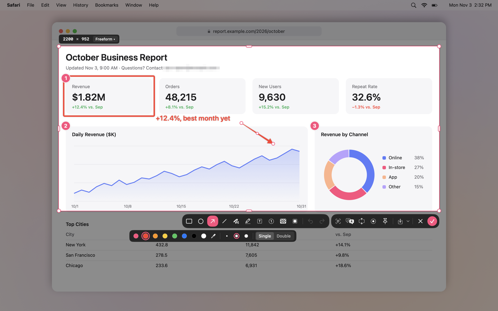
</p>

- **Selection**: the screen freezes before you select; hovering detects windows, and the selection snaps to window and screen edges. Type an exact size or lock the aspect ratio, or keep the screen at its normal colors instead of dimming it
- **Rounded corners and shadows**: the selection frame and the captured image have rounded, transparent corners (adjust them in Settings › Screenshot › Corner radius, or drag all the way left for square corners); clicking a whole window captures it with the window’s own rounded corners and shadow, and parts covered by other windows come out as the window’s own content
- **Detect elements in windows** (off by default): hovering picks out buttons, text fields, sidebars, file names and links, and the scroll wheel moves in and out of them; the Dock and menu bar can be captured by hovering too. Turn on “Also detect elements in web pages” to outline parts of pages in browsers
- **Magnifier color picker**: press C to copy the `#RRGGBB` under the pointer; the hints and the magnifier shown while selecting can be turned off
- **10 annotation tools**: rectangle, ellipse, arrow (bend it into an arc, or make it double-headed), line, pen, highlighter, text (adjustable font size), counter, blur and spotlight, switched with the number keys 1–0. Annotations stay editable—move them, drag corners and edges to resize (⇧ keeps proportions, ⌥ resizes from the center), duplicate them—with undo and redo; an eyedropper picks colors from the screenshot; crop too, trimming a scrolling capture or an older screenshot
- **Blur**: a real Gaussian blur that keeps text unreadable even at the light setting, or pixelate instead; “Auto” covers phone numbers, email addresses, bank card numbers and ID numbers in one go
- **Output**: ↩ copies (or copies a PNG file, which gets through clipboards shared between computers), ⌘S saves a PNG, T pins it to the screen for reference (drag to select text right on a pin, ⌘C to copy, or right-click to translate, search or look it up), O captures text (QR codes included), and one click sends it to Translate
- **Change the keys used while capturing**: right-click any button on the toolbar to change its key—21 in all; the toolbar sits to the right of the selection by default, or centered if you prefer
- **Scrolling Capture**: after selecting, press S and scroll inside the selection to stitch it together, or press Space to scroll automatically (at a speed you choose); annotate the result afterwards with the same ten tools; Kitty Tools’ own Settings and All Notes windows can be captured too
- **Timed Screenshot**: counts down 5 or 10 seconds before you select, so you can capture tooltips and pop-ups that disappear at a keypress
- **Screenshot History**: screenshots, scrolling captures, pinned screenshots, screen and audio recordings and GIFs all in one place, sorted by date, searchable and filterable; double-click one to keep editing its annotations on the original, copy it again or pin it back where it was
- After capturing, a thumbnail waits in the lower-right corner or hangs on the Clothesline at the top of the screen; drag it out as a file or click “Edit Annotations” to keep editing. Screenshots can include the pointer, and desktop icons can be hidden in screenshots and recordings; results like recognized text and picked colors pop out of the notch

<p align="center">
  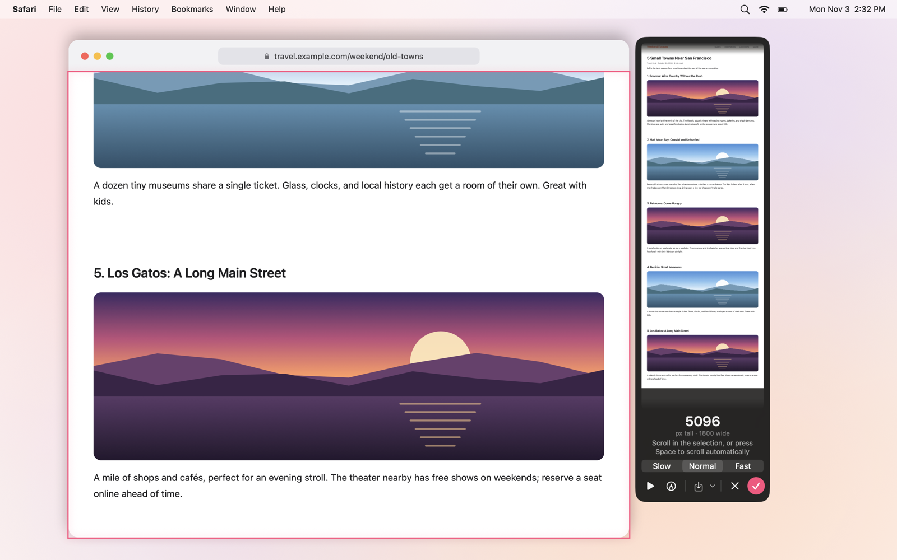
</p>

### 🎬 Screen and Audio Recording

- **Record Screen**: select an area or a whole screen just like a screenshot and press ↩; recording starts after a 3-second countdown by default. Records system audio and the microphone (choose which microphone), and can show clicks and keys pressed; a timer runs in the menu bar, and pressing the shortcut again stops and saves
- **Record Audio**: a control bar comes up first so you can choose the source (microphone, system audio or both) before starting, with live levels; saved as m4a
- **Pause and resume**: screen and audio recordings can both be paused; while paused nothing is recorded and the microphone is released, the timer doesn’t count the pause, and stopping joins everything into one file. Pause / Resume Recording can be given a shortcut in Settings › Shortcuts
- The finished video card waits in a corner of the screen: copy it, drag it away, **convert it to GIF** or compress it; frame rate, quality and H.264 / HEVC are in Settings › Recording

### ⚙️ Settings

<p align="center">
  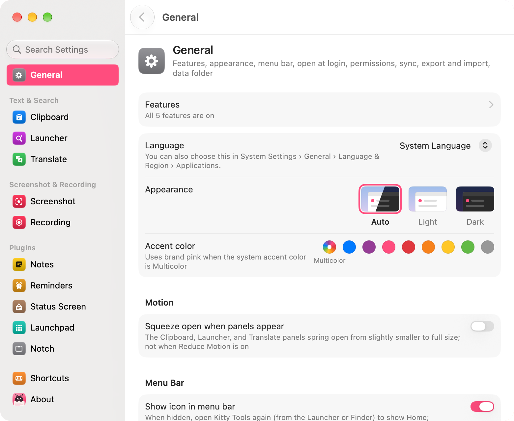
</p>

Appearance (Auto / Light / Dark), 8 accent colors, launch at login, permission status and recording global shortcuts are all in the Settings window, whose sidebar is grouped by feature: each page shows what you use most, groups open on their own page, rarely changed options are under Advanced…, and details are behind the ⓘ at the end of each row. Search in the sidebar takes you straight to a setting, and resting on a few settings plays a preview of the effect. A shortcut can also be a double press of ⌘, ⌥, ⌃ or ⇧, and shortcuts can be turned off in specific apps, handing the keys to them. The menu bar icon can be shown in color or hidden entirely (shortcuts keep working).

- **Features and Plugins**: Settings › General › Features has a switch for each feature; turning one off stops its entry points, shortcuts and background work, and turning it back on brings them back right away. Plugins live on the Plugins page in the sidebar, with the ones you’ve added at the top and the rest grouped by what they’re for; open one you haven’t added to see what it does and what it needs before adding it. First-run setup takes you through both
- **Language**: choose System Language, 简体中文 or English in Settings › General › Language. New installs follow the system; Macs updating from an earlier version stay in Chinese
- **Sync**: choose a folder (iCloud Drive, for example) or connect straight to a WebDAV server (WebDAV from a cloud storage provider, or your own NAS), and settings and shortcuts, snippets and favorites, the Word List, web searches, translation services, Status Screen statuses, Launcher Favorites, notes and reminders sync between Macs, with a switch for each kind; keys don’t sync
- **Backup and export**: a backup is made every day (the latest 7 are kept, and a copy can also go to another folder); settings and data can be exported to a single file and imported again (keys can be included, encrypted)
- **Keyboard Shortcuts**: “Show All Shortcuts…” on each settings page lists them by feature, searchable, opening at the feature you came from
- **Updates**: the menu bar tells you about new versions, which download in the background and install when you quit, and you can skip a version; “Report a Problem” on the About page opens a new GitHub issue with only the version and system version filled in

## macOS plugins

These are plugins: add them in Settings › Plugins. A plugin you haven’t added doesn’t appear or run; once added it has entry points, shortcuts and a settings page just like a feature. New installs start with none added; Macs updating from an earlier version keep the ones that were on.

### 🗒️ Notes

<p align="center">
  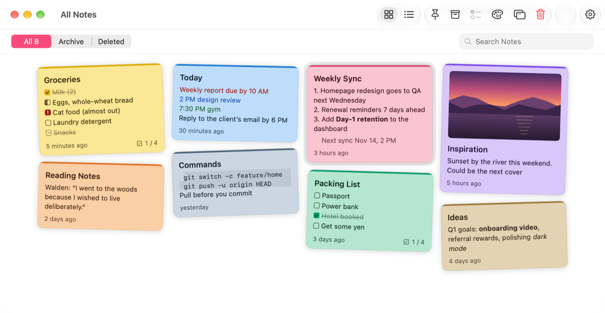
</p>

- **Quick Note** (`⌥N`): a small box pops up over any app; save it as a new note or add it to the end of one you edited recently; ⌘V pastes images
- **The stack on the screen edge**: a pill sits on the edge of the screen; move the pointer to it and the tabs fan out, click one to write, and you’re back in your app when you’re done; a shortcut can call up the stack too, then ↑↓ to choose and ↩ to open
- **All Notes**: the Note Wall (a masonry of cards) or a list; search, archive and pin, and sort by Recently Modified; select several (⌘A for all) to delete, archive, pin or recolor them at once, undone in one step; deleted notes stay in Recently Deleted for 30 days
- **Floating Notes**: drag a note out and leave it on the desktop; pinned, it stays above other windows and comes back to the same place after a restart
- **Text**: plain text with Markdown styling (headings, lists, quotes, code blocks, links), five task states, text colors, inline images (crop them, choose a width), find within a note, undo and redo; pasting from the web or documents keeps links, bold, headings, lists and code (as Markdown), and ⌥⇧⌘V pastes plain text
- Export everything or a single note as Markdown and import it again; works with Clipboard History, the Launcher and Translate Selection; its own database and daily backups

### 🔔 Reminders

<p align="center">
  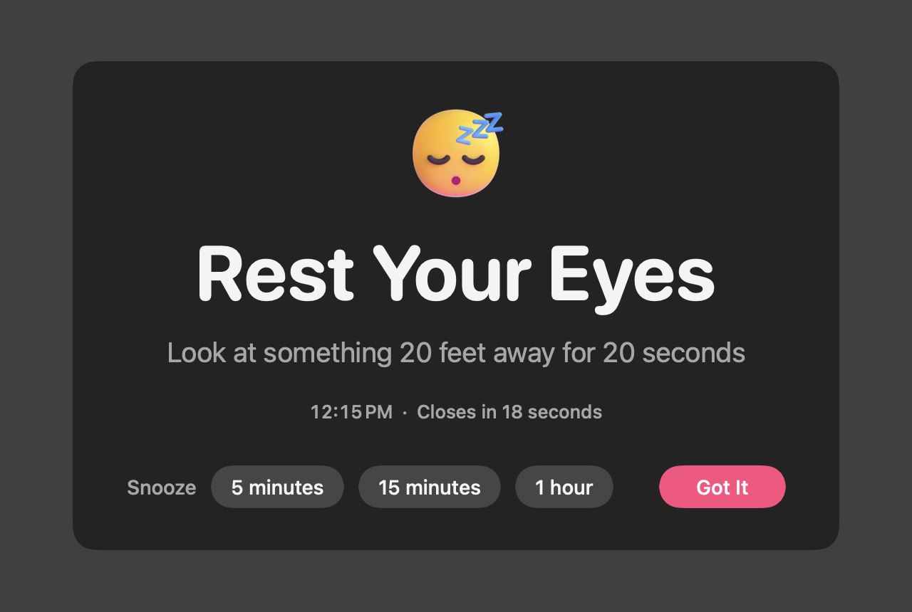
</p>

- Set a time and the reminder appears on the Notch when it’s due—click “Got It” or “Snooze”; ring once, or repeat every day, every weekday, every week, every month or at an interval
- Each reminder can go full screen, flash the screen border or be read aloud, or switch straight to the Status Screen when it’s due; if you don’t respond it nags again after a while (1–120 minutes), going full screen the third time
- Create one in a sentence from the Launcher: `remind me in 10 min to stretch` (English understands “in how long”; Chinese also understands a day and time); “New Reminder” is in the menu bar and on Home, and can have a shortcut
- Alert sounds can be system sounds, sounds you’ve added or any audio file; reminders sync when sync is on
- **Focus aware**: during any Focus (Do Not Disturb, Sleep, Work or ones you made), a due reminder only shows an icon on the Notch, without popping up or making a sound, and they all come up when the Focus ends. In Settings › Reminders you can have them wait until it ends or ring as usual instead, or choose per Focus with a Focus filter in System Settings; turn on “Ring as usual during a Focus” for an important one

### 🔲 Launchpad (macOS 26 and later)

- A full-screen grid of app icons over a blurred version of your wallpaper: page through it, and just start typing to search
- Drag to rearrange, drop icons onto each other to make folders, and hold an icon to jiggle and delete apps installed from the App Store
- Opens with a four- or five-finger pinch on the trackpad, following your fingers; a hot corner works too
- Hide apps you don’t want to see in Settings › Launchpad › Hidden Apps (they still show up in search), and add a row of frequently used apps at the top, ordered by how often you open them (off by default)
- The first time it opens, pages and folders are arranged the way the system Launchpad had them; it doesn’t appear on macOS 15 (use the system’s own)

### ✋ Status Screen

<p align="center">
  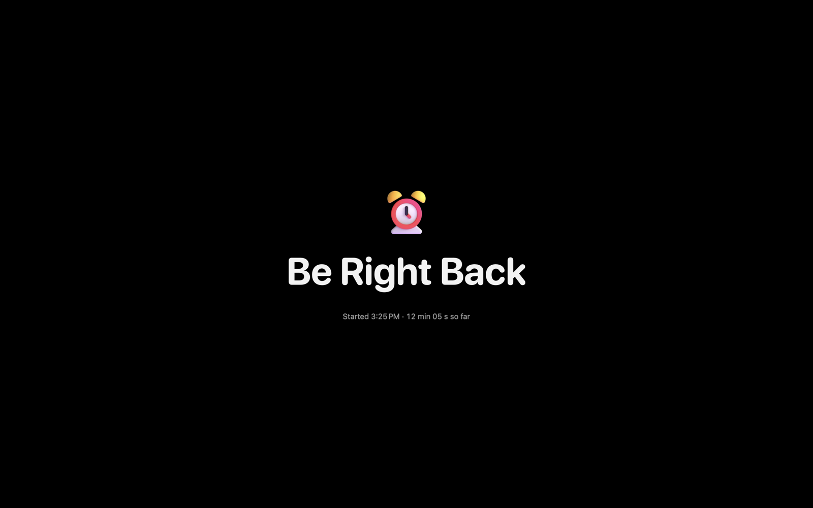
</p>

- One press covers every screen with a notice (“Clean Screen”, “Do Not Touch” and “Be Right Back” come built in) and blocks the keyboard and mouse—for wiping the screen, keeping hands off a Mac that’s running a job, or stepping away from your desk
- Change the notice’s text, icon and style; icons can be any system emoji (animated ones download the first time you use them, about 0.2 MB each). Keep several statuses and pick one with the shortcut before entering
- Hold Esc for 2 seconds (or hold the hint at the bottom of the screen with the mouse) to exit, optionally behind a passcode

### 🪟 Dock Preview

<p align="center">
  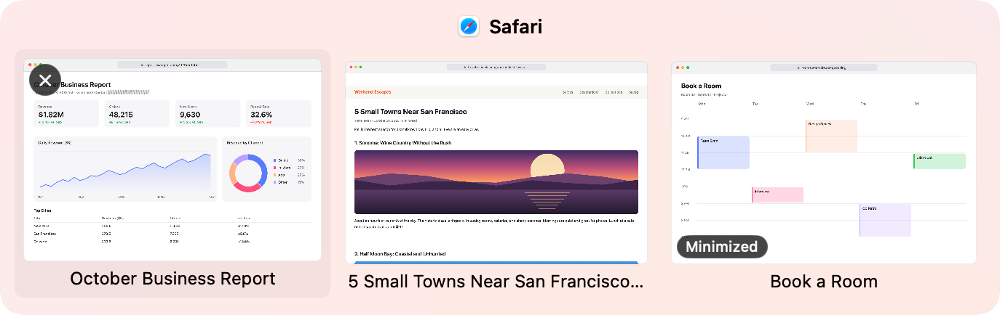
</p>

- Hover over an app in the Dock to see thumbnails of all its windows (including minimized, hidden and ones on other desktops); click one to switch to it, or hover and click ✕ to close it
- Window previews also appear while switching apps with ⌘Tab; how long to wait before showing them is adjustable (0.4 seconds by default)
- Needs Accessibility access; thumbnails need Screen Recording access

### 🗂️ Finder Menu

- Right-click in Finder: copy paths and names, open with a chosen app, create new files (text, Markdown, document, spreadsheet, presentation, or from the text or image on the clipboard), move or copy to favorite folders, cut and paste, make aliases—optionally all in one submenu
- **Cut with ⌘X, move with ⌘V** (off by default, needs Accessibility access): cut and move files in Finder with the keyboard; when nothing is cut, ⌘V pastes as usual
- Compress to zip / 7z / TAR.GZ (TAR.GZ opens on Linux and Windows 11 without extra software; skip things like node_modules, .git and *.log, each common one with its own switch), Extract Here (zip, 7z, rar, tar, gz, bz2 and more, asking for passwords when needed; hold ⌥ for “Extract To…” to choose where; optionally move the archive to the Trash afterwards), with a progress bar on the Notch that can be stopped
- **Copy Text from Image**: right-click images to copy the text in them, or the contents of a QR code; several at once
- Undo “Move To”, “Copy To” and cut and paste from the Notch; when there’s no room next to the file (a read-only disk), put the result in Downloads or choose another place
- Put a “Kitty Tools” button on the Finder toolbar for the same items: in iCloud Drive (including Desktop and Documents synced to iCloud) and cloud storage folders, where the system leaves them out of the context menu, it still works
- Fix garbled file names copied from other computers, copy SHA-256 / MD5 / SHA-1 (compared with a checksum on the clipboard if there is one), toggle hidden files and extensions, delete immediately
- After adding the plugin, follow the prompt to turn on the Finder extension once in System Settings

### 🏝️ Notch

Copied, saved, something went wrong—notices grow out of the notch, and hovering over one expands it to show the full text and buttons (“Show in Finder”, “Undo”, “Retry”…). That part is always there and doesn’t need the plugin. The Notch plugin adds:

- **Focus**: when a Focus turns on, off or changes, the notch widens for 2 seconds with the Focus’s icon and name on the left (in its own color) and On or Off on the right; while it’s on, its icon stays on the left of the notch, and clicking it opens Focus settings. Focuses you made yourself work too, with no permission needed; optionally play a sound when Sleep turns on, and hold back system notices during a Focus
- **Activities beside the notch**: a timer while recording the screen or audio (click to stop); reminders due within an hour count down, and you can finish them early or snooze them for 5 minutes; compressing, copying, extracting and other tasks longer than 3 seconds shrink to the sides with their progress. On displays without a notch they sit in the menu bar
- **Now Playing** (off by default): artwork and a bouncing level meter beside the notch while music or video plays; open it to drag the progress bar, play/pause, change tracks, set shuffle and repeat and adjust the output volume, all tinted to match the artwork (or your accent color, or white). While Music is playing, click a heart to favorite the song. Swipe left or right with two fingers on the notch to change tracks; while you’re in the app that’s playing, the sides fold away
- **Next Event** (off by default, needs Calendars access): starting 10 minutes before an event, a countdown sits beside the notch; open it for the time and location, and join video meetings in one click; use calendar colors, choose which calendars to read, mark days with events on the month calendar, and play a sound when an event starts
- **System Notices** (off by default): when you plug in or unplug power, the battery runs low or headphones connect, the notch widens for a few seconds with the battery level; it also pops up when the network drops and comes back. The volume and brightness indicators can move to the notch too; Low Power Mode turning on or off gets a notice, and a low battery shows how long it has left
- **The card that opens from the notch**: a row of quick actions (Take Screenshot, Capture Text, Translate Screenshot, Record Screen, Record Audio, Quick Note) that you can turn off and drag to reorder, plus recent notices and this month’s calendar if you want them. With the pointer on the notch, swiping down with two fingers opens it too; on displays without a notch, use the shortcut
- **More options** (all off by default): an hourly chime, hiding the Notch in screenshots and recordings or when the front app is full screen, and an outline around it; notice duration, how soon it expands when you hover, and the look of the volume and brightness row are adjustable

### ☕ Keep Awake

- Keeps your Mac awake indefinitely, for a few hours or until a set time; turn it on from the menu bar, Home, a shortcut or the Launcher (`awake 2h`)
- Keep the display on too, or only prevent system sleep and let the display turn off; or turn it on automatically on a schedule (weekdays 9:00–18:00, for example)
- While you’ve turned it on, it sits beside the notch; click to stop it

### 🖱️ Smooth Scrolling

- A regular mouse wheel glides like a trackpad, with adjustable glide time and distance per notch; reverse the mouse on its own (the Magic Mouse too) while the trackpad stays the same
- Hold ⌥ to scroll without smoothing for a moment, or ⇧ to scroll sideways; games, virtual machines and remote desktops are left alone automatically, and you can add other apps
- Needs Accessibility access

### ⌨️ App Shortcuts

- Hold ⌘ on its own for a moment in any app (or ⌥, ⌃ or ⇧, held for 0.6–2 seconds as you choose) to see every shortcut in its menus: grouped by menu in columns that run on, with the shortcuts lined up in one column and the system’s Move & Resize items folded into one row you can expand; a shortcut can open it too
- Once it’s up, keep holding ⌘ and also hold ⇧, ⌥, ⌃ or 🌐 to highlight only the shortcuts that use those keys
- Press another key while holding and it goes to the app as usual; click a row to run it, or click the search field to keep the list open and type to search
- Needs Accessibility access

### 🔀 Key Remapping

- Set system-level key mappings for one specific keyboard: F1–F24, Caps Lock, the left and right modifier keys, letters and numbers, arrow keys, the keypad and media keys can all be remapped, including to 🌐 Globe / Fn (say, to give an external keyboard a Fn key)
- The system does the mapping, so your keystrokes aren’t watched; mappings come back after the keyboard reconnects or your Mac wakes, and removing the plugin undoes the rules it wrote
- Remapping letters, numbers and similar keys needs Input Monitoring access (the system requires it)

### 🌙 Bluetooth Sleep (MacBook)

- Turns Bluetooth off when you close the lid and your Mac sleeps, so a Bluetooth mouse or keyboard won’t wake it in your bag; on waking, only the Bluetooth it turned off comes back on
- Stays on while an external display is connected, or turns off every time if you prefer; the system asks for Bluetooth access when you add it

## Default macOS shortcuts

| Feature | Shortcut |
|---|---|
| Clipboard History | `⌥C` |
| Launcher | `⌥Space` |
| Translate Selection | `⌥D` |
| Type to Translate | `⌥T` |
| Translate Screenshot | `⌥S` |
| Take Screenshot | `⌥A` |
| Capture Previous Area | `⌥X` |
| Capture Text (OCR / QR codes) | `⌥O` |
| Record Screen | `⌥R` |
| Quick Note (Notes) | `⌥N` |

Translate and Replace Selection, Record Audio, Pause / Resume Recording, Screenshot History, Clothesline, Pin Clipboard Content, New Note, All Notes, New Reminder, Launchpad, Status Screen, Open Notch, Open Home, Keep Awake, App Shortcuts and the notes stack on the screen edge have no shortcut by default—record one in Settings › Shortcuts when you need it. Every shortcut can be changed there, including to a double press of a modifier key. Shortcuts don’t work while their feature is off or their plugin isn’t added: new installs only turn on Clipboard, Launcher, Translate and Screenshot, so turn on Recording in Settings › General › Features for Record Screen, and add the Notes plugin for Quick Note. macOS 15.0 and 15.1 don’t allow shortcuts with only ⌥; on those versions, use a combination with ⌘ or ⌃ (the Shortcuts page tells you).

While another app is taking a password (macOS has Secure Input on), shortcuts that use only ⌥ with a letter, number or symbol can’t fire—macOS doesn’t allow it, and there’s no way around it. When that happens, the menu bar icon shows a small orange lock; hover over it to see which app has Secure Input on and how to turn it off. To use a shortcut even in password fields, give it ⌃ or ⌘, or make it a double press of a modifier (⌥Space isn’t affected).

## Installing the macOS version

1. Download `Kitty.Tools_x.y.z_arm64.dmg` from [Releases](https://github.com/YyAdnBug/kitty-tools/releases/latest) (on a Mac with Intel, `_x86_64.dmg`; the `.zip` files and `macos-update.json` are for in-app updates, so you don’t need to download them), or build it yourself as described below.
2. Drag `Kitty Tools.app` into Applications.
3. The app is signed with an Apple Development certificate but not notarized, so macOS blocks it the first time you open it (the message says it was “Not Opened”, not that it’s “damaged”). Go to System Settings › Privacy & Security and click “Open Anyway”. Or run this in Terminal:
   ```bash
   xattr -dr com.apple.quarantine "/Applications/Kitty Tools.app"
   ```
4. Follow first-run setup to grant permissions (it only asks for what the features you picked need):
   - **Accessibility**: pasting back into the app you were using, Translate Selection, replacing the original text, auto-scrolling in Scrolling Capture, showing keys while recording, Dock Preview, detecting elements while capturing, double-pressing modifier keys, expanding snippets by keyword, showing volume and brightness on the notch, Smooth Scrolling, App Shortcuts
   - **Screen Recording**: Screenshot, Translate Screenshot, Capture Text, Scrolling Capture, Record Screen, recording system audio, Dock Preview thumbnails (you may need to reopen the app after granting it)
   - **Microphone**: recording your voice with Record Screen and Record Audio, asked the first time it’s needed
   - **Files and Folders**: requested only when the Launcher searches files
   - **Full Disk Access** (optional): only needed to search Safari bookmarks and history
   - **Calendars** (optional): asked only when you turn on Next Event for the Notch
   - **Bluetooth** (optional): asked only when you add Bluetooth Sleep
   - **Input Monitoring** (optional): only when Key Remapping remaps letters, numbers and similar keys
   - **Finder extension** (for Finder Menu): after adding the plugin, click “Turn On…” in Settings › Finder Menu and turn it on once in System Settings

You only need to allow it the first time. After that, when a new version is out, the menu bar shows “Update to x.y.z…” and it updates in one click, with no need to allow it again.

> After a new install (or a major macOS update), the system has to prepare a text recognition model for the app before the first recognition, which takes about a minute. The app prepares it in the background once it starts; if you happen to use it before it’s ready, the Notch says it’s preparing the model and how long it has waited. After that, recognition is instant. To make the first recognition faster, turn off “Unload the text recognition model when idle” in Settings › Screenshot › Advanced so the model stays loaded.

## Building the macOS version from source

The code is on the `macos` branch. You need Xcode 26.3 or later and a Mac with Apple silicon; there are no third-party dependencies.

```bash
git clone -b macos https://github.com/YyAdnBug/kitty-tools.git
cd kitty-tools
xcodebuild -project macos/KittyTools.xcodeproj -scheme KittyTools build
```

- **Signing**: change `DEVELOPMENT_TEAM` in `macos/Config/Base.xcconfig` to your own Team ID.
- **Built-in Zhipu key (optional)**: create `macos/Config/Secrets.xcconfig` (ignored by `.gitignore`, never committed) containing `ZHIPU_BUILTIN_KEY = your Zhipu API key`. It builds fine without it; you’ll just need to enter a key for Zhipu in Settings.
- **Build a DMG**: `macos/build-dmg.sh` (add `ARCH=x86_64` in front for Intel); the output is in `macos/build/`.

```bash
# Unit tests
xcodebuild -project macos/KittyTools.xcodeproj -scheme KittyTools test

# UI snapshots: renders each screen offscreen (light and dark) as PNG; some of this README’s screenshots come from here
# (add -testLanguage en -testRegion US for the English interface)
TEST_RUNNER_KITTY_SNAPSHOT_DIR=/tmp/kitty-shots xcodebuild -project macos/KittyTools.xcodeproj -scheme KittyTools \
  test -only-testing:KittyToolsTests/SnapshotProbeTests
```

## Project structure

On the `macos` branch:

```
macos/
├── KittyTools/          # App/ Shell/ Storage/ Clipboard/ SnippetExpand/ Launcher/ Launchpad/ Translate/ Screenshot/ StatusScreen/ Notes/ Reminders/ DockPreview/ FinderMenu/ KeepAwake/ SmoothScroll/ AppShortcuts/ KeyRemapping/ BluetoothSnooze/ Settings/ Resources/
├── KittyToolsFinder/    # Finder extension: only draws the context menu and hands clicks to the app
├── KittyToolsNowPlaying/ # XPC service for the Notch’s Now Playing: reads what’s playing and sends playback commands for the app
├── KittyToolsTests/     # Unit tests and UI snapshots (Swift Testing)
├── Config/              # xcconfig build settings, Info.plist
├── build-dmg.sh         # Packaging: archive → checks → DMG + zip for in-app updates
├── brand-icons.swift    # Draws the app icon, menu bar icon and DMG background with Core Graphics
└── status-emoji.swift   # Status Screen’s animated emoji: animated PNGs to the HEICS files in the app
icons/                   # Feature icons shared by both versions (SVG) and the script that builds them
```

The interface text is in `macos/KittyTools/Resources/Localizable.xcstrings` (the development language is Simplified Chinese; the Chinese text is the key). How strings are written and the English glossary are in [`macos/TRANSLATION.md`](https://github.com/YyAdnBug/kitty-tools/blob/macos/macos/TRANSLATION.md). Development conventions (in Chinese) are in [AGENTS.md](https://github.com/YyAdnBug/kitty-tools/blob/macos/AGENTS.md) on the `macos` branch, with module specs in [.claude/skills/](https://github.com/YyAdnBug/kitty-tools/tree/macos/.claude/skills). For the Windows version’s structure and conventions, see [windows/AGENTS.md](https://github.com/YyAdnBug/kitty-tools/blob/windows/windows/AGENTS.md) on the `windows` branch.

## Acknowledgments

- The interaction and measurements of Notes draw on [Noty](https://github.com/aimen08/noty) (MIT); all the code was rewritten
- Status Screen’s animated emoji come from [Microsoft Fluent Emoji Animated](https://github.com/microsoft/fluentui-emoji-animated) (MIT)

## Friends

- [LinuxDo](https://linux.do): a friendly tech community (in Chinese)
