<p align="center">
  <a href="README.en.md">English</a> | <b>简体中文</b>
</p>

<p align="center">
  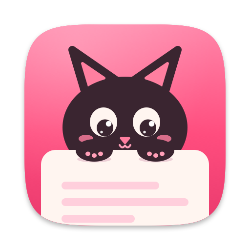
</p>

<h1 align="center">Kitty Tools</h1>

<p align="center">
  纯原生的效率工具，macOS 版和 Windows 版各写一套：剪贴板历史 · 启动器 · 翻译 · 截图 · 录屏录音 · 便签 · 提醒 · 启动台 · 状态屏 · 程序坞预览 · 访达右键 · 刘海岛 · 保持唤醒 · 平滑滚动 · App 快捷键 · 键位映射 · 睡眠关蓝牙
</p>

<p align="center">
  
  
  
  
  
  <a href="https://yyadnbug.github.io/kitty-tools/download/"></a>
</p>

<p align="center">
  <a href="https://yyadnbug.github.io/kitty-tools/"><b>官网</b></a> ·
  <a href="https://yyadnbug.github.io/kitty-tools/download/">下载与安装</a> ·
  <a href="https://yyadnbug.github.io/kitty-tools/changelog/">更新日志</a> ·
  <a href="https://yyadnbug.github.io/kitty-tools/faq/">常见问题</a>
</p>

<p align="center">
  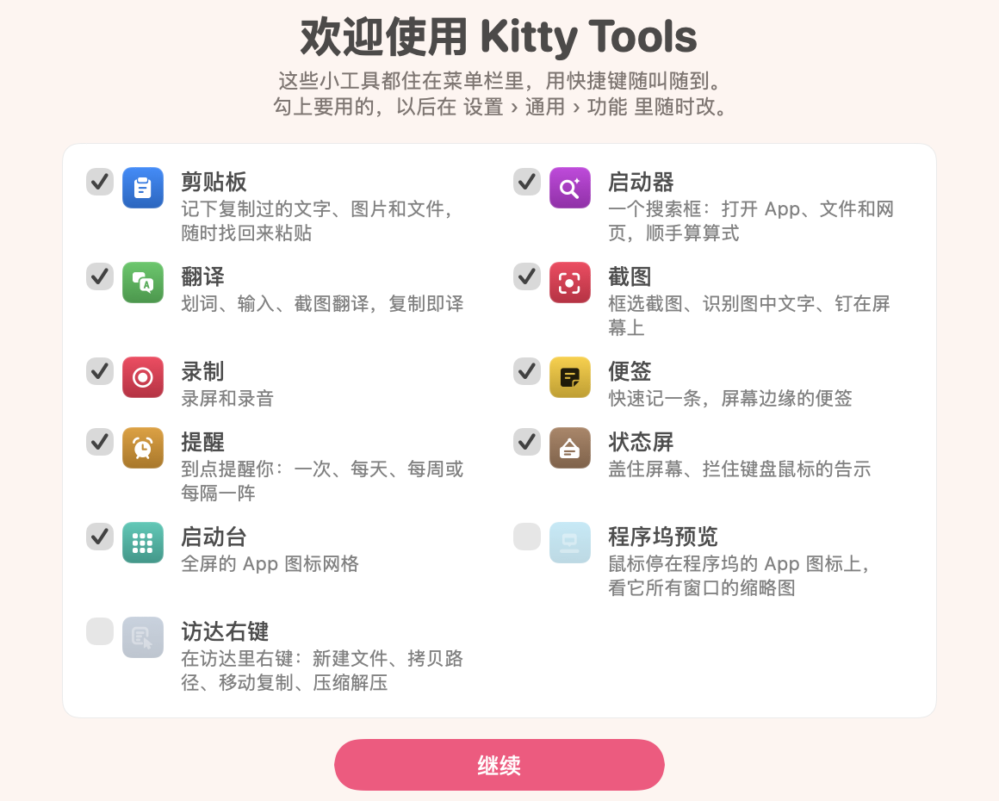
</p>

macOS 版用 Swift 6 + SwiftUI / AppKit 写成，常驻菜单栏、不占程序坞：点菜单栏图标打开主界面，全部功能一格一格摆着（直接打字就转到启动器里搜），也都能用全局快捷键或启动器呼出。弹出时不抢前台 App 的焦点，选好内容能直接粘贴回原来的 App。功能只有剪贴板、启动器、翻译、截图、录制五样（新装开前四样），便签、提醒、状态屏、启动台、程序坞预览、访达右键、刘海岛、保持唤醒、睡眠关蓝牙、平滑滚动、App 快捷键和键位映射做成了插件，要用时在 设置 › 插件 里添加，不添加就不出现、不运行；第一次打开时的引导里先挑一遍。界面有简体中文和 English，默认跟系统语言。识字、语种检测和敏感内容识别都在本机完成，密钥存在系统钥匙串里。提示从屏幕顶部的刘海冒出来，设置和数据每天自动备份、能在几台 Mac 之间同步（同步盘里的文件夹或 WebDAV 服务器）。支持浅色 / 深色外观，强调色可以自选；macOS 26 起 App 图标是分层图标，跟着系统的图标风格（深色、着色、透明）变。新版本在 App 内一键更新。

> 个人项目，持续更新中。macOS 版支持 macOS 15 及以上，Apple 芯片和 Intel 芯片各有一个安装包（Intel 版 0.10.0 起）；Windows 版支持 Windows 11 22H2 及以上（x64 / ARM64）。

## 分支

`main` 只放这份介绍和截图，代码按平台分在两个分支里：

| 分支 | 内容 | 发布 |
|---|---|---|
| [`macos`](https://github.com/YyAdnBug/kitty-tools/tree/macos) | macOS 版（Swift 6 + SwiftUI / AppKit），零第三方依赖 | tag `macos-v*`，最新一版标 latest |
| [`windows`](https://github.com/YyAdnBug/kitty-tools/tree/windows) | Windows 版（C# + .NET + WinUI 3，Native AOT），只用微软的包 | tag `windows-v*`，不标 latest |

两个版本的功能、样子和默认值尽量对齐；剪贴板片段、生词本、网页搜索、翻译服务、便签、提醒能在 Mac 和 Windows 之间同步。

## Windows 版

常驻托盘，全局快捷键呼出，界面跟着 Windows 11 的样子走（亚克力、Segoe 字体），功能和 mac 版对齐：剪贴板历史（片段、收藏夹、多选粘贴、拖出去）、翻译（八个服务、流式、划词 / 输入 / 复制即译、历史与生词本）、启动器（应用、设置页、系统命令、计算、文件搜索、浏览器书签、kill / port）、截图（标注、识字、钉图、截图翻译、长截图、截图历史）、录屏与录音、便签、提醒、状态屏，以及保持唤醒插件；截图能悬停认出窗口里的按钮、侧栏这类元素，同步能连 WebDAV 服务器，导出的设置能和 macOS 版互相导入。

从 [Releases](https://github.com/YyAdnBug/kitty-tools/releases) 里找 `windows-v` 开头的版本，下载 `KittyTools-x.y.z-windows-x64-setup.exe`（ARM 电脑下载 arm64 那个）双击安装，以后在程序里自动更新。代码、规矩和计划在 [`windows`](https://github.com/YyAdnBug/kitty-tools/tree/windows/windows) 分支的 `windows/` 下，入口是 `windows/AGENTS.md`。

## macOS 版的功能

剪贴板历史、启动器、翻译、截图、录屏与录音这五样是功能，每样都能在 设置 › 通用 › 功能 里整个关掉；关掉的入口、快捷键和后台活一起停，数据和设置都留着。

### 📋 剪贴板历史

<p align="center">
  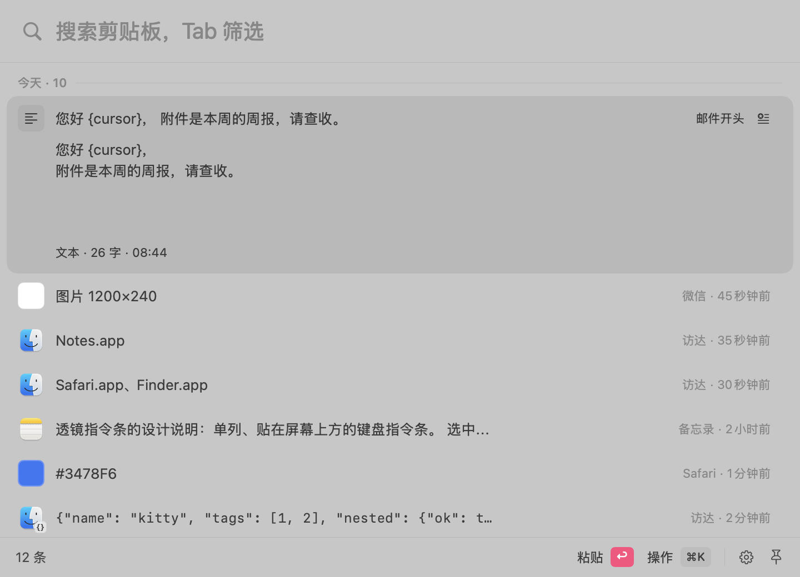
</p>

- 自动记录复制过的**文本（保留格式，图文混排的一段粘回去图片还在）、图片和文件**，重复内容只挪到最前面；远程控制、输入法跨设备同步过来的文字也记
- **键盘优先**：↩ 粘贴回原 App，⌥↩ 粘贴纯文本，⌘1–9 直接粘贴第 N 条，多选后合并粘贴，删除后 ⌘Z 连着撤销
- **透镜预览**：选中条目原地展开，代码 / JSON 带行号和语法着色，颜色显示 HEX / RGB / HSL，链接显示标题和头图；⌘Y（搜索框空着时按空格）放大预览
- **图片看得清**：图片条目直接显示成一张小图（长截图、手机截图看得到顶上一截），选中时原地放大；不想要可以在设置里关掉
- **搜索**：正文、图片里的文字（本机识别，不联网）、文件路径、备注、来源 App 都能搜；Tab 按类型、内容形态、来源 App、收藏夹筛选
- **收藏夹、片段、备注**：收藏可以分进多个收藏夹，任何条目都能写备注；片段支持 `{date}`、`{time}`、`{uuid}`、`{clipboard:N}`、`{cursor}` 等占位符，日期时间能偏移、自定格式（`{date+1d}`、`{date-1w:yyyy/MM/dd}`），`{input:称呼}` 粘贴前弹框填空；收藏和片段不会被自动清理
- **打关键词展开片段**：片段能设一个关键词，在任何 App 里打出它就换成片段的内容（`{cursor}`、`{input}` 照样能用，便签里也行）；新建片段时填，已有的在 ⌘K 里选「关键词…」；要辅助功能授权，不想要就在 设置 › 剪贴板 关掉「打关键词展开片段」
- **顺手的操作**：文件 ⌘O 打开、⌘R 在访达中显示，⌘T 翻译选中条目，图片和文字都能钉到屏幕，条目直接拖进别的 App
- **面板放哪**：出现在屏幕上方、跟着鼠标，或停在上次拖到的地方；拖左右两边、下边改大小
- **隐私**：跳过密码管理器和带隐私标记的内容，可排除指定 App、临时暂停记录（菜单栏图标挂一个暂停角标），自动拦截 API Key、Bearer Token、银行卡号等敏感文本；普通历史保留 1 天到永久，可限制图片占用，退出或锁屏时清空

### 🚀 启动器

<p align="center">
  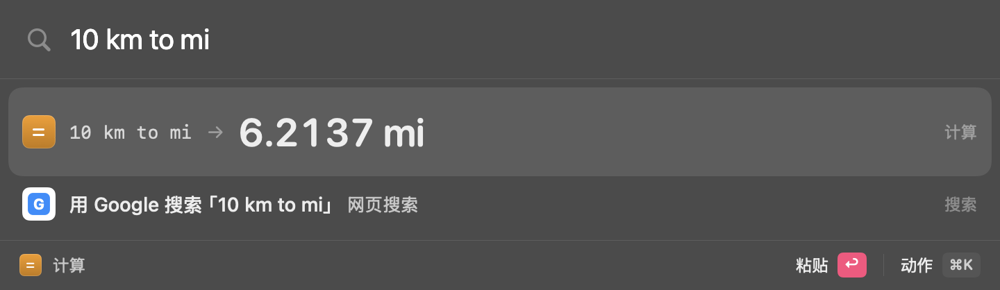
  <br><br>
  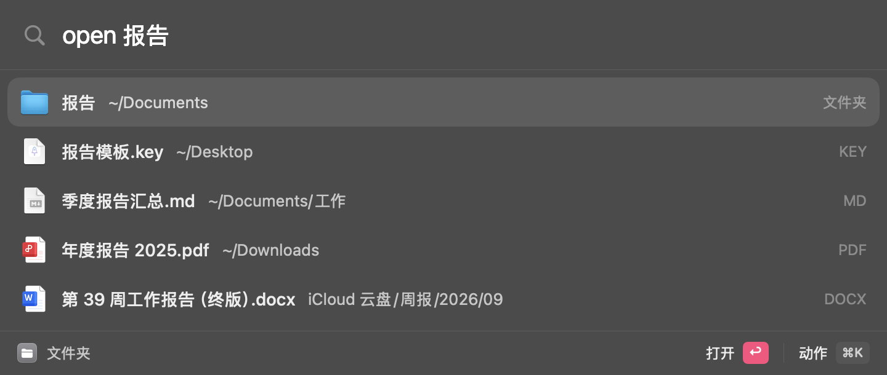
  <br><br>
  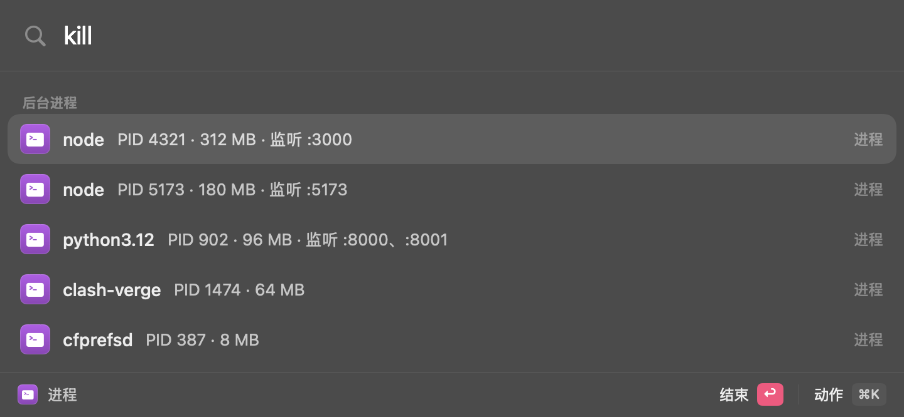
</p>

- **搜 App**：中文名、英文名、拼音全拼和首字母都能搜（「huodong」「hdjsq」都能找到活动监视器），按使用习惯排序（同一个字选过一次，下次就排第一），iPad App 也能用中文名搜到，界面换成英文后中英文名照样都能搜；⌘D 收藏常用项，空输入时排在最前
- **文件搜索**：`open 文件名` 打开，`find 文件名` 在访达中选中，支持中文和拼音；⌘Y 快速查看，⌘K 用其他 App 打开或移到废纸篓；⇧↑↓ 或 ⌘ 点按能勾好几个（浏览文件夹时也行），↩ 一起打开、⌘↩ 一起在访达中显示；打开后 90 秒内再呼出启动器，回到原来的搜索和选中的那一行
- **浏览文件夹**：输入以 `/` 或 `~` 开头的路径，直接列出文件夹里的东西，没打完的按名字筛；Tab 进文件夹、⇧Tab 回上一级，↩ 打开；文件的 ⌘K 里还能在终端中打开、拷贝文件、复制终端写法的路径
- **计算器与换算**：四则运算、百分比、乘方、函数；单位换算（`10 km to mi`、`30 摄氏度 转 华氏度`）、进制转换（`255 in hex`）、汇率（`100 usd`、`100美元转人民币`，联网取，断网时用上次存的），↩ 直接粘贴结果
- **脚本命令**：脚本文件夹里的每个脚本就是一条命令，能带参数（下拉选项、密码），结果拷贝、粘贴、显示全文（边跑边显示、认终端颜色）或列成一张能打开网址和文件的列表；自带 8 个（Unix 时间戳、Base64、URL 编解码、JSON 格式化、进制转换、正则测试、UUID、切换深色模式），复制 AI 写好的脚本点「从剪贴板新建」就能用
- **命令和别名**：内置命令和脚本都能改要打的词、关掉不用的，每条命令还能设一个快捷键直接运行；App 也能起别名（给微信填 `wx`，输 `wx` 就是它）
- **系统命令**：`lock`、`sleep`、`restart`、`emptytrash`、`mute` 等（中文、拼音也行）；`quit` / `hide` / `forcequit` 管理正在运行的 App，`eject` 推出磁盘，`kill` 结束进程或按端口找（`kill :3000`），`port` 看哪些端口被占着、是谁占的（`port 3000`），`ip` 列出本机的局域网和外网地址
- **快捷指令**：打「快捷指令」App 里某条快捷指令的名字就能运行
- **搜菜单项**：添加了 App 快捷键插件后，能搜前台 App 的菜单项（没有快捷键的也搜得到），↩ 切回那个 App 执行
- **系统设置直达**：搜「蓝牙」「显示器」「隐私与安全」，↩ 跳到对应的设置页
- **网页搜索**：`g swift`、`gh swift` 这样用关键词直达，预置 Google、Bing、百度、GitHub、知乎、哔哩哔哩等 13 个引擎，可自定义搜索和快捷链接
- **浏览器书签与历史**：Safari、Chrome、Edge、Arc、Brave、Firefox 等，只列本机装了的，带网站图标；输入网址直接打开
- `cb 关键词` 跳到剪贴板历史搜索，`fy 文字` 直接翻译，`remind 10分钟 喝水` 建一条提醒（英文也认：`remind me in 10 min to stretch`），⌘K 或 → 打开动作菜单

### 🌐 翻译

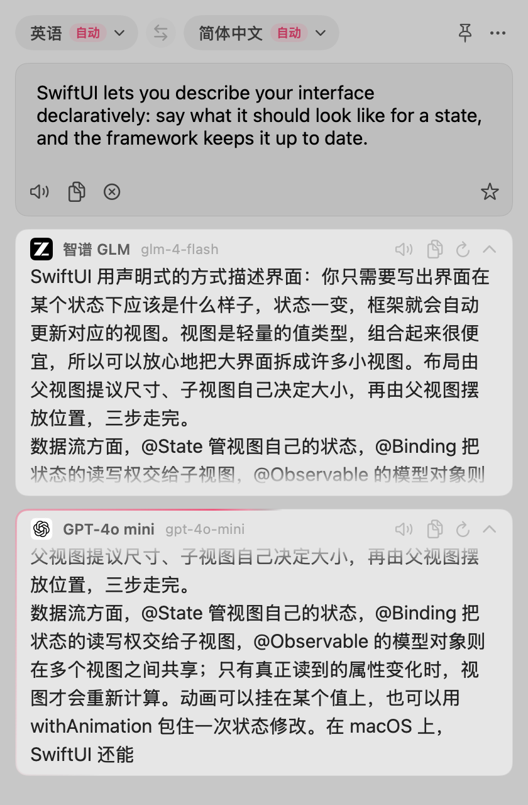

- **划词翻译**：在任意 App 里选中文字按快捷键就翻译，浮窗出现在屏幕上方正中（也能改成跟着鼠标）；取不到选区时自动改用 ⌘C 取词，用完把剪贴板恢复原样
- **输入翻译、复制即译、截图翻译**：框选屏幕上的文字，本机识别后翻译；译文也能直接盖回截图上，放不下的段放进旁边的译文卡片
- **多服务并行**：智谱 GLM（内置，开箱即用）、系统翻译和有道词典（不用密钥）、百度、有道、Google、DeepL / DeepLX、微软（不填密钥也能用）、火山、腾讯，以及 OpenAI / Azure OpenAI / Anthropic 协议的大模型；DeepSeek、Kimi、通义千问、硅基流动、OpenRouter、Gemini、Ollama 等有预设，填好密钥就能用；大模型的译文边生成边显示；设置里标出免费的服务，不常用的折叠起来，点开才翻、不耗额度
- **讲解句子**：大模型服务打开「讲解外文句子」后，一句外文译成第一语言时，除了译文还列出三到五个重点词和句型，方便学外语；每个大模型服务还能写「附加要求」（比如「术语保留英文」）
- **查词**：单个词显示系统词典释义卡片，按词性、义项、例句排好，英文单词放真人发音；大模型按词典格式回答
- **替换原文**：用译文直接替换原 App 里选中的文字，也可以设一个静默热键，一按即替换
- **翻译历史 / 生词本**：可搜索、收藏，导出 CSV 或可直接导入 Anki 的 TSV
- 支持 30 种语言（越南语、泰语、印尼语、阿拉伯语、土耳其语、荷兰语、波兰语、乌克兰语……），目标语言选「自动」时在第一 / 第二语言之间互译；很长的文字按段、按句切开依次翻，不会翻到一半就断；支持朗读（能放慢、加快）、自动复制译文

<br clear="right">

### ✂️ 截图

<p align="center">
  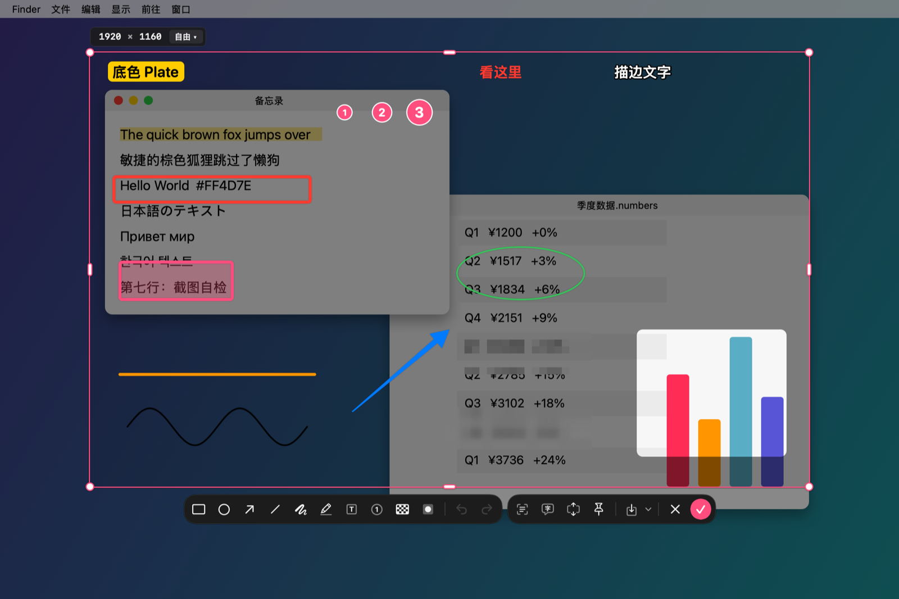
</p>

- **框选**：先冻结屏幕再框选，悬停自动识别窗口，吸附窗口边和屏幕边；尺寸可直接输入，比例可锁定；也可以不压暗屏幕、保持原色
- **圆角和阴影**：框和截出来的图带圆角、四角透明（设置 › 截图「截图圆角」能调，拖到最左是直角）；单击整扇窗口截下时带窗口自己的圆角和阴影，被别的窗口挡住的地方也截成它自己的内容
- **识别窗口里的元素**（默认关）：悬停认出按钮、输入框、侧栏、文件名、链接这类，滚轮往里钻或退出来，程序坞和菜单栏也能悬停截取；再打开「也认网页里的元素」，浏览器里的网页也能一块块框出来
- **放大镜取色**：按 C 复制光标处的 `#RRGGBB`；框选时的操作提示和放大镜都能关
- **10 种标注工具**：矩形、椭圆、箭头（可拖成弧线、能选双头）、直线、画笔、荧光笔、文字（能调字号）、序号、打码、聚光灯，用数字键 1–0 切换；标注画完后仍能移动、拖角和边改大小（⇧ 保持比例、⌥ 从中心缩放）、复制，支持撤销 / 重做；吸管从截图里取色；还能裁剪，长截图拼完、改旧截图时去掉多余的部分
- **打码**：真正的高斯模糊，弱档也认不出字，也能换成像素方块；选「自动」一下盖住截图里的手机号、邮箱、银行卡号和身份证号
- **出图**：↩ 拷贝（也可以设成拷贝 PNG 文件，两台电脑共用剪贴板时传得过去），⌘S 保存 PNG，T 钉在屏幕上当参考（钉图上的字能直接拖选、⌘C 拷贝，右键翻译、搜索、查词典），O 识字（也能识别二维码），一键送去翻译
- **截图时的快捷键能改**：在工具栏上右键那颗钮就能换它的键，一共 21 个；工具栏默认贴在选区右边，也能换回居中
- **长截图**：框选后按 S，在选区里滚动就自动拼接，按空格自动滚动（速度能调）；拼完还能标注，十种工具和截图里的一样；Kitty Tools 自己的设置窗、全部便签也拍得到
- **延时截图**：数 5 或 10 秒再进框选，能截到工具提示和一按键就消失的弹层
- **截图历史**：截图、长截图、钉过的图、录屏录音和 GIF 都留在一处，按日期排好、能搜能筛；双击一张回到原图上接着改标注，还能重新拷贝、钉回原来的位置
- 截图后缩略图停在屏幕右下角，或挂到屏幕顶上的晾衣绳，可以直接拖出成文件、点「改标注」接着改；能设成截图带上鼠标指针、截图录屏时隐藏桌面图标；识字、取色等结果从刘海处弹出轻提示

<p align="center">
  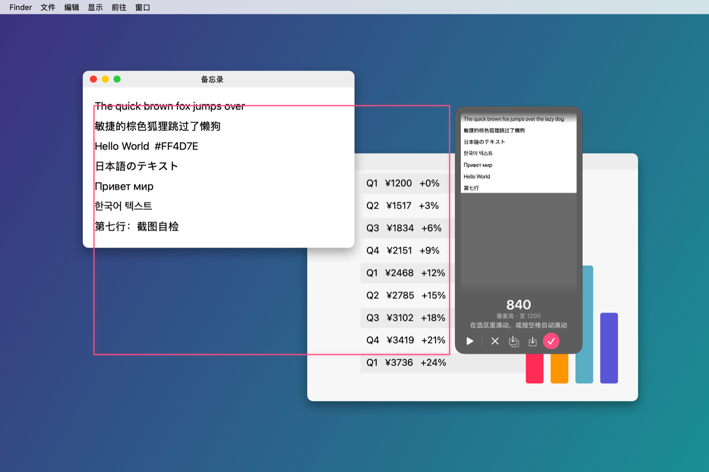
</p>

### 🎬 录屏与录音

- **录屏**：和截图一样框选一块区域或整块屏幕，↩ 开始，默认倒数 3 秒后开录；录系统声音和麦克风（能选用哪个麦克风），可以显示点按和按下的键；菜单栏计时，再按一次快捷键停止并保存
- **录音**：先出一个控制条，选好来源（麦克风 / 系统声音 / 两者）再开始，电平实时显示，存成 m4a
- **暂停 / 继续**：录屏、录音都能暂停，暂停时不录、不占麦克风，计时不算暂停的时间，停止时拼成一个文件；「暂停 / 继续录制」能在 设置 › 快捷键 里设一个快捷键
- 录完的视频卡停在屏幕角落，可以拷贝、拖走、**转成 GIF** 或压缩；帧率、清晰度、H.264 / HEVC 都能在 设置 › 录制 里选

### ⚙️ 设置

<p align="center">
  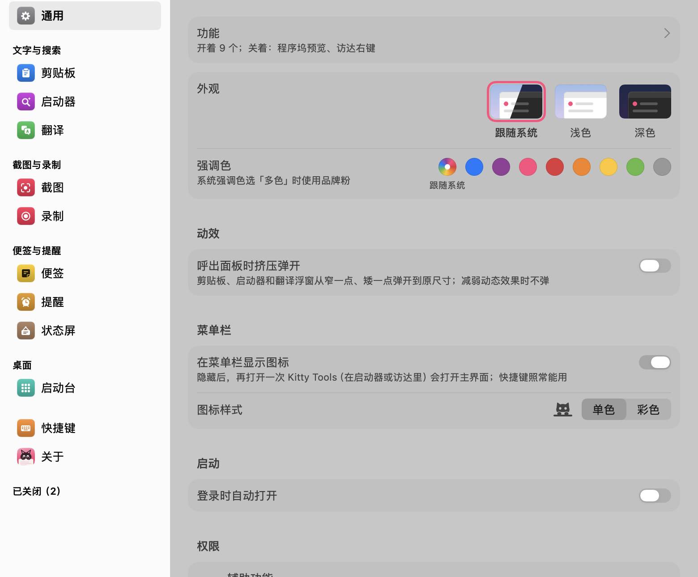
</p>

外观（跟随系统 / 浅色 / 深色）、8 种强调色、开机自启、权限状态、全局快捷键录制都在设置窗里，侧栏按功能分组：每页外面只放常用的，成组的点进下一页，不常改的收进「高级…」，细节点每一行右边的 ⓘ 看；侧栏的搜索直接落到那一项，停在几项设置上能看到效果演示。快捷键也能设成连按两下 ⌘ ⌥ ⌃ ⇧ 中的一个，也能在指定的 App 里停用、把按键让给它。菜单栏图标可以换成彩色，也可以整个隐藏（快捷键照常能用）。

- **功能和插件**：设置 › 通用 › 功能 里每个功能一个开关，关掉的入口、快捷键、后台活全都停掉，打开立即回来；插件都在设置侧栏的「插件」一页里，添加了的排在最上面，没添加的按用途分组，没添加的点进去先看能做什么、要什么授权再添加；第一次打开时的引导先让你挑一遍
- **语言**：设置 › 通用「语言」能选跟随系统、简体中文或 English；新装的跟系统，从旧版本升上来的保持中文
- **同步**：选一个文件夹（比如 iCloud 云盘），或者直接连 WebDAV 服务器（网盘的 WebDAV、自己的 NAS），设置与快捷键、片段和收藏、生词本、网页搜索、翻译服务、状态屏的状态、启动器收藏、便签、提醒就能在几台 Mac 之间同步，每类一个开关；密钥不同步
- **备份与导出**：每天自动备份一份（留最近 7 份，可以另存到别的文件夹），设置与数据能导出成一个文件再导入（密钥可以加密带上）
- **快捷键速查表**：各设置页的「查看全部快捷键…」，按功能分类、能搜索，从哪一页点开就停在哪一类
- **更新**：有新版本时菜单栏提示，默认在后台下好、退出时装上，也能跳过某个版本；关于页的「反馈问题」打开 GitHub 新建问题，只预填版本号和系统版本

## macOS 版的插件

下面这些是插件：在 设置 › 插件 里添加，不添加就不出现、不运行，添加了以后和功能一样有入口、快捷键和设置页。新装一个都不添加；从旧版本升上来的，原来开着的照旧开着。

### 🗒️ 便签

<p align="center">
  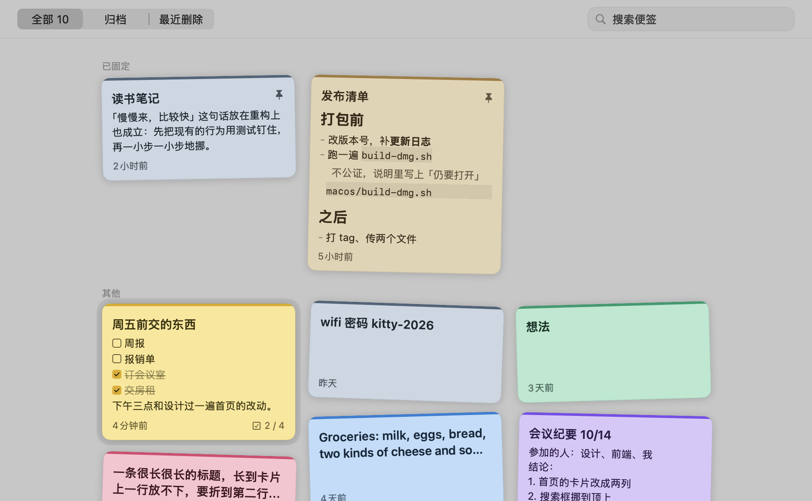
</p>

- **快速记一条**（`⌥N`）：在任何 App 里弹出一个小框，记成新便签，或接在最近改过的某一条后面；⌘V 能贴图
- **屏幕边缘的那叠**：药丸贴在屏幕边上，鼠标靠过去扇出标签，点开就写，写完接着回原来的 App；也能设一个快捷键叫出那一列，↑↓ 选、↩ 打开
- **全部便签**：便签墙（卡片瀑布流）和列表两种看法，能搜索、归档、固定，按最近修改排；能多选（⌘A 全选）整批删除、归档、固定、换色，一次就能撤销；删掉的留 30 天能放回
- **浮在屏幕上**：把便签拖出来钉在桌面，固定后一直在别的窗口上面，重启后回到原处
- **正文**：纯文本 + Markdown 样式（标题、列表、引用、代码块、链接），五种任务状态、文字颜色、行内图片（能裁切、选宽度）、便签内查找、撤销重做；从网页、文稿粘进来保留链接、粗体、标题、列表和代码（转成 Markdown），⌥⇧⌘V 粘纯文本
- 整个或单条导出成 Markdown，再导回来；和剪贴板、启动器、划词翻译打通；单独的库和每日备份

### 🔔 提醒

<p align="center">
  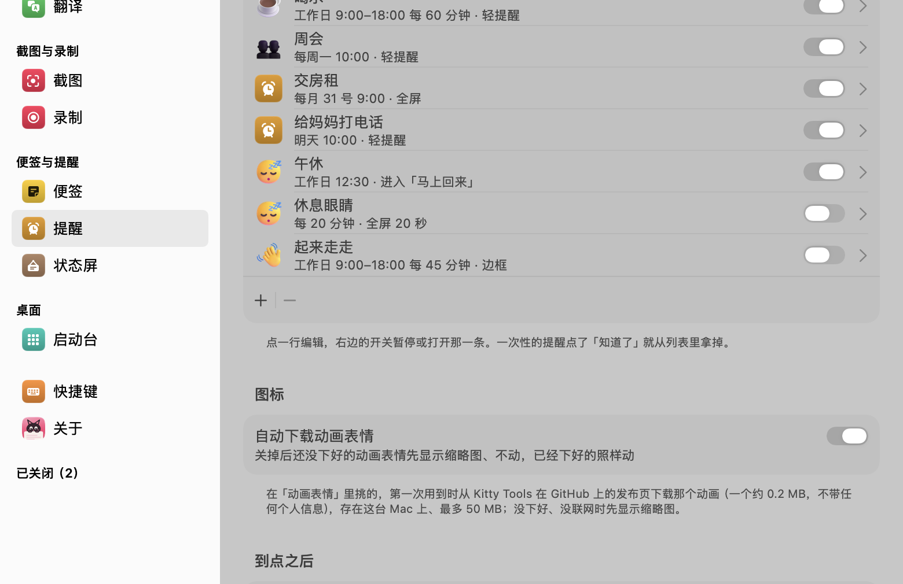
</p>

- 设好时间，到点挂在刘海岛上，点「知道了」或「稍后」；只响一次，或每天、工作日、每周、每月、隔一段时间重复
- 每条可以选全屏、闪屏幕边框、读出来，也能到点直接进入状态屏；没理会时隔一阵再催（1–120 分钟），第 3 次换成全屏
- 启动器里一句话建好：`remind 10分钟 喝水`、`提醒 明天9点 交周报`；菜单栏和主界面有「新提醒」，也能设快捷键
- 提示音能选系统声音、自己放的声音或任意音频文件；开着同步时提醒跟着同步
- **认专注模式**：开着任何专注模式（勿扰、睡眠、工作、自己建的）时，到点的提醒只在刘海上挂个图标，不弹出、不出声，结束后一起弹；在 设置 › 提醒 里能改成「先不提醒，结束后再响」或「照常提醒」，也能在系统的专注模式滤镜里给某几个模式另选；要紧的那条在详情里打开「专注模式时也照常提醒」

### 🔲 启动台（macOS 26 起）

- 全屏的 App 图标网格，背景是桌面壁纸糊开的样子：一页一页翻，打开就能直接打字搜（中文名、拼音、首字母都行）
- 拖动排序、拖到一起建文件夹，按住图标进入抖动模式删除从 App Store 装的 App
- 四指 / 五指捏合触控板打开，画面跟着手指走；也可以设一个触发角
- 不想看到的 App 能藏起来（设置 › 启动台 › 隐藏的 App，搜索照样搜得到）；还能在顶上放一排常用的 App，按用得多少排（默认关）
- 第一次打开时按系统原来的启动台排好页和文件夹；macOS 15 上不出现（用系统自带的）

### ✋ 状态屏

<p align="center">
  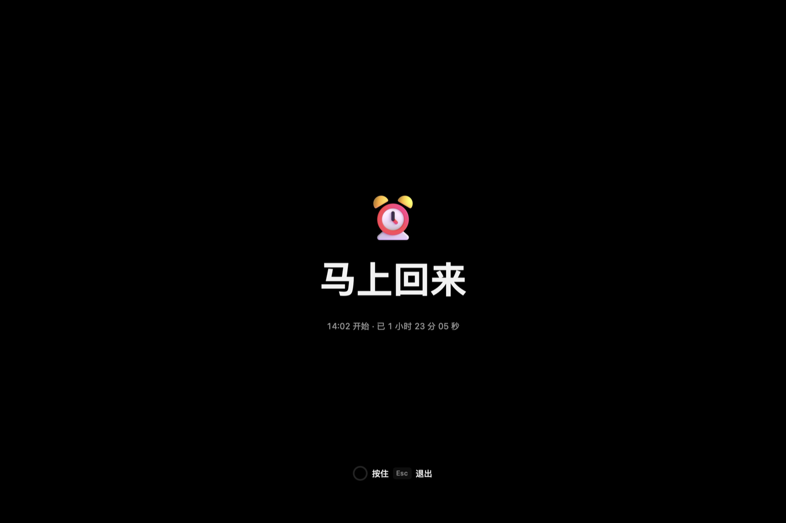
</p>

- 一键把所有屏幕盖上一块告示（自带「清洁屏幕」「请勿触碰」「马上回来」），同时拦住键盘鼠标，擦屏幕、电脑在跑任务不想被人碰、离开座位时用
- 告示的文字、图标、样式都能自己改，图标能挑任意系统表情（有动画版的第一次用到时下载，一个约 0.2 MB）；可以有好几个状态，按快捷键先选一个再进
- 按住 Esc 2 秒（或用鼠标按住屏幕底部的提示）退出，可以再加一道退出密码

### 🪟 程序坞预览

<p align="center">
  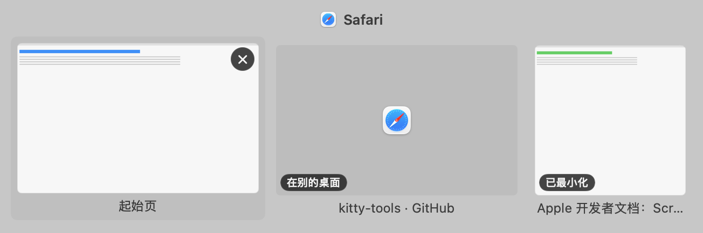
</p>

- 鼠标停在程序坞的 App 图标上，上方弹出它所有窗口的缩略图（最小化的、隐藏的、别的桌面上的也列出来），点一张切过去，悬停点 ✕ 关掉
- 按 ⌘Tab 切换 App 时也弹窗口预览；鼠标停多久再弹能调（默认 0.4 秒）
- 要辅助功能授权，有屏幕录制授权才有缩略图

### 🗂️ 访达右键

- 在访达里右键：拷贝路径和名称、用指定 App 打开、新建文件（文本、Markdown、文档、表格、演示文稿，或者用剪贴板里的文字、图片新建）、移动 / 复制到常用文件夹、剪切粘贴、做替身，可以收进一个子菜单
- **⌘X 剪切、⌘V 移动**（默认关，要辅助功能授权）：在访达里直接用快捷键剪切、移动文件，没剪切时 ⌘V 照常粘贴
- 压缩成 zip / 7z / TAR.GZ（TAR.GZ 在 Linux、Windows 11 上不用另装软件就能解开；能跳过 node_modules、.git、*.log 这类文件，常见的一项一个开关）、解压到这里（zip、7z、rar、tar、gz、bz2 等，带密码的会问密码；按住 ⌥ 换成「解压到…」自己选位置；能设成解压后把压缩包移到废纸篓），刘海岛上有进度条、能停
- **拷贝图中文字**：右键图片，把图里的字拷进剪贴板，有二维码就拷它的内容；能一次选好几张
- 「移动到」「复制到」「剪切 → 粘贴」做完，刘海岛上能撤销；包旁边放不下（只读的盘）时能换到「下载」或另选位置
- 访达工具栏能放一个「Kitty Tools」按钮，点开就是右键里的这几项：iCloud 云盘（包括同步到 iCloud 的桌面、文稿）和网盘的文件夹里系统不给右键项，用它照样能用
- 修复从别的电脑拷来的乱码文件名，拷贝 SHA-256 / MD5 / SHA-1（剪贴板里有校验值时顺带比一下），切换隐藏文件、隐藏扩展名，彻底删除
- 添加插件后，按提示到系统设置里打开一次访达扩展

### 🏝️ 刘海岛

复制好了、存好了、出错了这些提示都从刘海里长出来，鼠标挪上去停住、展开看全文和按钮（「在访达中显示」「撤销」「重试」…）。这一部分一直都在，不用添加插件；刘海岛插件再加上这些：

- **专注模式**：打开、关掉、换专注模式时刘海两边出 2 秒，左边是模式的图标和名字（用模式自己的颜色），右边「开」或「关」；开着的时候刘海左边一直挂着它的图标，点开能去专注模式设置。自己建的模式也认，不要任何授权；还能设成睡眠模式打开时响一声、专注时不弹系统提示
- **刘海两边的活动**：录屏、录音时挂着计时，点开能停；一小时以内的提醒在刘海上倒数，能提前结束或推后 5 分钟；压缩、拷贝、解压这类超过 3 秒的活缩到两边显示进度；没有刘海的屏挂在菜单栏上
- **正在播放**（默认关）：放歌、放视频时刘海两边是封面和跳动条，点开能拖进度条、暂停、切歌、换随机和循环、调输出音量，颜色跟着封面走（也能换成强调色、白色）；放「音乐」时点一颗心收藏这首；在刘海上双指左右滑直接切歌；正在用放歌的 App 时刘海两边先收起
- **下一个日程**（默认关，要日历授权）：日程开始前 10 分钟挂在刘海两边倒数，点开有时间和地点，视频会议一键加入；能用日历的颜色、选读哪些日历，月历上标出有日程的日子，日程开始时能响一声
- **系统提示**（默认关）：接上 / 拔掉电源、电量低、耳机连上时刘海往两边长开几秒，带上电量；断网和网络恢复时弹一下；按音量键、亮度键时的提示也能换到刘海上；低电量模式打开、关掉时说一声，电量低时写上还能用多久
- **点刘海打开的那一张**：一排快捷动作（截图、识字、截图翻译、录屏、录音、快速记一条），能逐个关掉、拖动排序，也能列出最近的提示、显示这个月的日历；指针停在刘海上两指往下滑也能打开，没有刘海的屏幕用快捷键打开
- **更多开关**（都默认关）：整点报时、截图录屏时不显示刘海岛、前台 App 全屏时藏起来、给刘海岛描一圈细边；提示停多久、停在刘海上多久展开、音量亮度那一行的样式都能调

### ☕ 保持唤醒

- 不让 Mac 睡着：无限期、几小时，或到某一刻；菜单栏、主界面、快捷键或启动器（`awake 2小时`、`保持唤醒 到18点`）都能开
- 能连屏幕也不熄，或只防系统睡眠、屏幕照常熄；也能按时段自动开（比如工作日 9:00–18:00）
- 手动开着时挂在刘海两边，点开能停

### 🖱️ 平滑滚动

- 普通鼠标的滚轮像触控板那样滑着滚，滑多久、拨一格滚多远都能调；鼠标能单独反向（妙控鼠标也行），触控板不变
- 按住 ⌥ 临时不平滑，按住 ⇧ 左右滚；游戏、虚拟机、远程桌面自动照原样，别的 App 也能加进停用名单
- 要辅助功能授权

### ⌨️ App 快捷键

- 在任何 App 里单独按住 ⌘ 一会儿（键能换成 ⌥ ⌃ ⇧，按多久 0.6–2 秒能调），弹出它菜单里的全部快捷键：按菜单分组、各栏连着排，快捷键对成一列，系统的「移动与调整大小」收成一行、点开再看；也能设一个快捷键打开
- 弹出来后按着 ⌘ 再按住 ⇧ ⌥ ⌃ 或 🌐，只亮带这些键的快捷键
- 按着它再按别的键照常给 App；点一行直接执行，点一下搜索框能留住、打字搜（中文也认拼音）
- 要辅助功能授权

### 🔀 键位映射

- 给某一把键盘单独设系统级的键位映射：F1–F24、Caps Lock、左右的修饰键、字母数字、方向键、小键盘、媒体键都能换，也能映射成 🌐 Globe / Fn（比如让外接键盘的某个键当 Fn 用）
- 映射交给系统做，不看你按了什么键；键盘重新连上、电脑醒来后自动补上，移除插件时撤销它写进去的规则
- 改字母、数字这类键时，系统要「输入监听」授权

### 🌙 睡眠关蓝牙（MacBook）

- 合上盖子睡下去时关掉蓝牙，放进包里不会被蓝牙鼠标、键盘弄醒；醒来只打开睡前自己关掉的蓝牙
- 接着外接显示器时不关，也能改成每次睡眠都关；添加时系统会问蓝牙授权

## macOS 版的默认快捷键

| 功能 | 快捷键 |
|---|---|
| 剪贴板历史 | `⌥C` |
| 启动器 | `⌥Space` |
| 划词翻译 | `⌥D` |
| 输入翻译 | `⌥T` |
| 截图翻译 | `⌥S` |
| 截图 | `⌥A` |
| 截取上次区域 | `⌥X` |
| 识字（OCR / 二维码） | `⌥O` |
| 录屏 | `⌥R` |
| 快速记一条（便签） | `⌥N` |

划词翻译并替换、录音、暂停 / 继续录制、截图历史、晾衣绳、钉住剪贴板内容、新建便签、全部便签、新建提醒、启动台、状态屏、打开刘海岛、打开主界面、保持唤醒、App 快捷键、屏幕边缘的便签默认不设，需要时到「设置 › 快捷键」里自己录。所有快捷键都能在那里改，也能设成连按两下某个修饰键。功能关着、插件没添加时它的快捷键不生效：新装默认只开剪贴板、启动器、翻译、截图，录屏的快捷键要先在 设置 › 通用 › 功能 里打开录制，快速记一条要先添加便签插件。macOS 15.0 / 15.1 不允许注册只带 ⌥ 的组合，在这两个版本上请改成带 ⌘ 或 ⌃ 的组合（快捷键页会提示）。

别的 App 在输密码时（系统开着安全输入），只带 ⌥ 的字母、数字、符号快捷键按不出来，这是系统的规定、绕不过去；这时菜单栏图标会出一把橙色小锁，悬停能看到是哪个 App 开着、怎么关。要在密码框里也能用，换成带 ⌃ 或 ⌘ 的组合，或连按两下修饰键（⌥Space 不受影响）。

## 安装 macOS 版

1. 从 [Releases](https://github.com/YyAdnBug/kitty-tools/releases/latest) 下载 `Kitty.Tools_x.y.z_arm64.dmg`（Intel 芯片的 Mac 下载 `_x86_64.dmg`；`.zip` 和 `macos-update.json` 是 App 内更新用的，不用手动下载），或按下面的步骤自己打包。
2. 把 `Kitty Tools.app` 拖进「应用程序」。
3. App 使用 Apple Development 签名、没有公证，第一次打开会被系统拦下（提示「未打开」，不是「已损坏」）：到「系统设置 › 隐私与安全」里点「仍要打开」。也可以在终端执行：
   ```bash
   xattr -dr com.apple.quarantine "/Applications/Kitty Tools.app"
   ```
4. 按首次启动的欢迎引导授权（只问你挑了的功能要的）：
   - **辅助功能**：粘贴回原 App、划词翻译、替换原文、长截图自动滚动、录屏显示按键、程序坞预览、截图识别窗口里的元素、连按修饰键、打关键词展开片段、音量亮度键的提示换到刘海上、平滑滚动、App 快捷键
   - **屏幕录制**：截图、截图翻译、识字、长截图、录屏、录系统声音、程序坞预览的缩略图（授权后可能需要重新打开 App）
   - **麦克风**：录屏、录音时录下你的声音，第一次用到时才问
   - **文件和文件夹**：只在启动器文件搜索时按需申请
   - **完全磁盘访问权限**（可选）：只在要搜 Safari 书签和历史时需要
   - **日历**（可选）：只在刘海岛打开「下一个日程」时问
   - **蓝牙**（可选）：只在添加睡眠关蓝牙时问
   - **输入监听**（可选）：只在键位映射改字母、数字这类键时要
   - **访达扩展**（用访达右键时）：添加插件后在 设置 › 访达右键 里点「去打开…」，到系统设置里打开一次

只有第一次安装要放行；之后有新版本时菜单栏会出现「更新到 x.y.z…」，一键更新，不用再放行。

> 新装（或系统大版本更新）后的第一次识字，系统要先为本 App 准备识字模型，大约要一分钟。App 启动后会在后台自己准备好；要是赶上还没准备完，刘海岛会说「正在准备识字模型」并显示已等了多久，之后识字都是一眨眼的事。想让第一次识字更快，到 设置 › 截图 › 高级 关掉「空闲时释放识字模型」，模型就一直留着。

## 从源码构建 macOS 版

代码在 `macos` 分支。需要 Xcode 26.3 及以上和 Apple 芯片的 Mac，没有任何第三方依赖。

```bash
git clone -b macos https://github.com/YyAdnBug/kitty-tools.git
cd kitty-tools
xcodebuild -project macos/KittyTools.xcodeproj -scheme KittyTools build
```

- **签名**：`macos/Config/Base.xcconfig` 里的 `DEVELOPMENT_TEAM` 改成你自己的 Team ID。
- **内置智谱密钥（可选）**：新建 `macos/Config/Secrets.xcconfig`（已被 `.gitignore` 忽略，不会提交），写入 `ZHIPU_BUILTIN_KEY = 你的智谱 API Key`。不配置也能正常构建，只是智谱翻译需要在设置里自己填密钥。
- **打 DMG**：`macos/build-dmg.sh`（Intel 版前面加 `ARCH=x86_64`），产物在 `macos/build/`。

```bash
# 单元测试
xcodebuild -project macos/KittyTools.xcodeproj -scheme KittyTools test

# 界面截图自检：屏幕外渲染各界面（含深色）为 PNG，本 README 的截图就来自这里
TEST_RUNNER_KITTY_SNAPSHOT_DIR=/tmp/kitty-shots xcodebuild -project macos/KittyTools.xcodeproj -scheme KittyTools \
  test -only-testing:KittyToolsTests/SnapshotProbeTests
```

## 项目结构

`macos` 分支：

```
macos/
├── KittyTools/          # App/ Shell/ Storage/ Clipboard/ SnippetExpand/ Launcher/ Launchpad/ Translate/ Screenshot/ StatusScreen/ Notes/ Reminders/ DockPreview/ FinderMenu/ KeepAwake/ SmoothScroll/ AppShortcuts/ KeyRemapping/ BluetoothSnooze/ Settings/ Resources/
├── KittyToolsFinder/    # 访达扩展：只画右键菜单，点了交给 App 去做
├── KittyToolsNowPlaying/ # 刘海岛「正在播放」的 XPC 服务：读正在放的歌、替 App 发播放命令
├── KittyToolsTests/     # 单元测试与界面截图自检（Swift Testing）
├── Config/              # xcconfig 构建设置、Info.plist
├── build-dmg.sh         # 打包：archive → 自检 → DMG + App 内更新用的 zip
├── brand-icons.swift    # 用 CoreGraphics 生成 App 图标、菜单栏图标和 DMG 背景
└── status-emoji.swift   # 状态屏的动画表情：动画 PNG 转成包里用的 HEICS
icons/                   # 两个版本共用的功能图标（SVG）和生成脚本
```

开发约定见 `macos` 分支的 [AGENTS.md](https://github.com/YyAdnBug/kitty-tools/blob/macos/AGENTS.md)，各模块规范见 [.claude/skills/](https://github.com/YyAdnBug/kitty-tools/tree/macos/.claude/skills)。Windows 版的结构和约定见 `windows` 分支的 [windows/AGENTS.md](https://github.com/YyAdnBug/kitty-tools/blob/windows/windows/AGENTS.md)。

## 致谢

- 便签的交互和数值参考了 [Noty](https://github.com/aimen08/noty)（MIT），代码全部自己重写
- 状态屏的动画表情来自 [Microsoft Fluent Emoji Animated](https://github.com/microsoft/fluentui-emoji-animated)（MIT）

## 友情链接

- [LinuxDo](https://linux.do)：说话好听、个个都是大佬的技术社区
