<p align="center">
  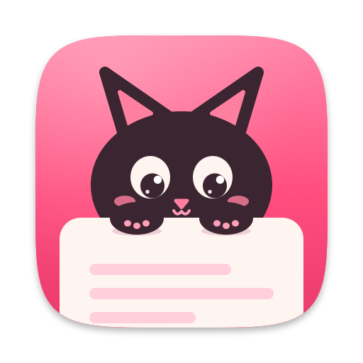
</p>

<h1 align="center">Kitty Tools</h1>

<p align="center">
  纯原生的效率工具，macOS 版和 Windows 版各写一套：剪贴板历史 · 启动器 · 翻译 · 截图 · 录屏录音 · 便签 · 启动台 · 状态屏 · 程序坞预览
</p>

<p align="center">
  
  
  
  
  
  <a href="https://github.com/YyAdnBug/kitty-tools/releases/latest"></a>
</p>

<p align="center">
  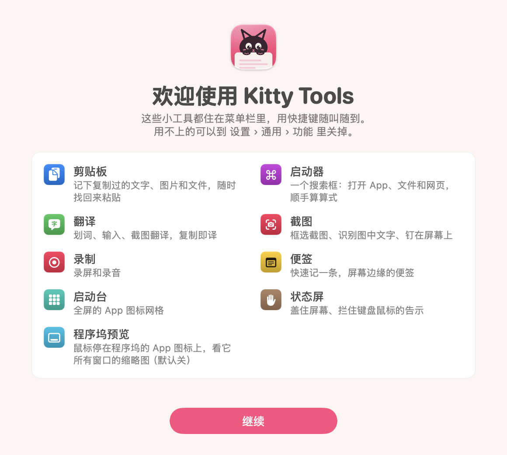
</p>

macOS 版用 Swift 6 + SwiftUI / AppKit 写成，常驻菜单栏、不占程序坞。九个功能都用全局快捷键（或菜单栏、启动器）呼出，弹出时不抢前台 App 的焦点，选好内容能直接粘贴回原来的 App；用不上的功能可以在设置里整个关掉。识字、语种检测和敏感内容识别都在本机完成，密钥存在系统钥匙串里。提示从屏幕顶部的刘海冒出来，设置和数据每天自动备份、能在几台 Mac 之间同步。支持浅色 / 深色外观，强调色可以自选，新版本在 App 内一键更新。

> 个人项目，持续更新中。macOS 版只支持 Apple 芯片、macOS 15 及以上；Windows 版支持 Windows 11 22H2 及以上（x64 / ARM64）。

## 分支

`main` 只放这份介绍和截图，代码按平台分在两个分支里：

| 分支 | 内容 | 发布 |
|---|---|---|
| [`macos`](https://github.com/YyAdnBug/kitty-tools/tree/macos) | macOS 版（Swift 6 + SwiftUI / AppKit），零第三方依赖 | tag `macos-v*`，最新一版标 latest |
| [`windows`](https://github.com/YyAdnBug/kitty-tools/tree/windows) | Windows 版（C# + .NET + WinUI 3，Native AOT），只用微软的包 | tag `windows-v*`，不标 latest |
| [`windows-next`](https://github.com/YyAdnBug/kitty-tools/tree/windows-next) | Windows 版下一版正在做的功能，做完并回 `windows` | — |

两个版本的功能、样子和默认值尽量对齐；剪贴板片段、生词本、网页搜索、翻译服务能在 Mac 和 Windows 之间同步。

## Windows 版

常驻托盘，全局快捷键呼出，界面跟着 Windows 11 的样子走（亚克力、Segoe 字体），功能和 mac 版对齐：剪贴板历史（片段、收藏夹、多选粘贴、拖出去）、翻译（八个服务、流式、划词 / 输入 / 复制即译、历史与生词本）、启动器（应用、设置页、系统命令、计算、文件搜索、浏览器书签、kill / port）、截图（标注、识字、钉图、截图翻译、长截图、截图历史）、录屏与录音。

从 [Releases](https://github.com/YyAdnBug/kitty-tools/releases) 里找 `windows-v` 开头的版本，下载 `KittyTools-x.y.z-windows-x64-setup.exe`（ARM 电脑下载 arm64 那个）双击安装，以后在程序里自动更新。代码、规矩和计划在 [`windows`](https://github.com/YyAdnBug/kitty-tools/tree/windows/windows) 分支的 `windows/` 下，入口是 `windows/AGENTS.md`。

## macOS 版的功能

### 📋 剪贴板历史

<p align="center">
  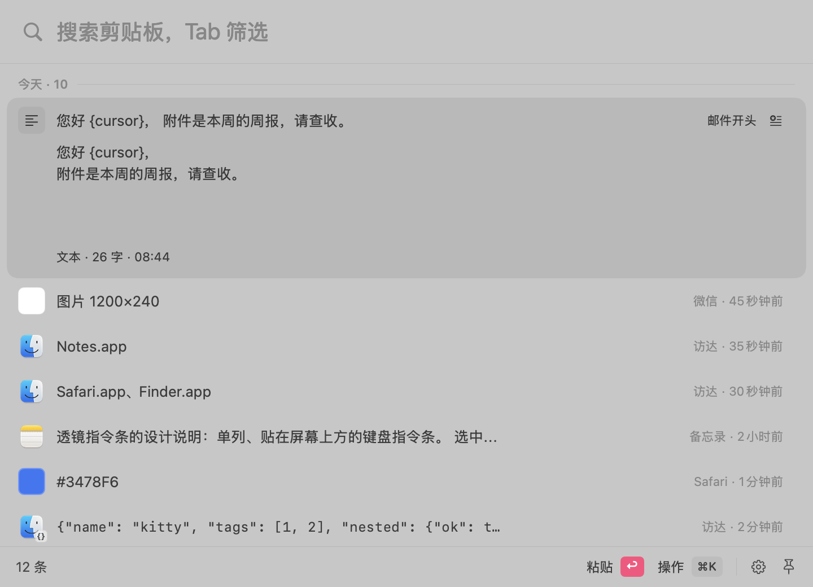
</p>

- 自动记录复制过的**文本（保留格式）、图片和文件**，重复内容只挪到最前面
- **键盘优先**：↩ 粘贴回原 App，⌥↩ 粘贴纯文本，⌘1–9 直接粘贴第 N 条，多选后合并粘贴，删除后 ⌘Z 连着撤销
- **透镜预览**：选中条目原地展开，代码 / JSON 带行号和语法着色，颜色显示 HEX / RGB / HSL，链接显示标题和头图；⌘Y 放大预览
- **搜索**：正文、图片里的文字（本机识别，不联网）、文件路径、备注、来源 App 都能搜；Tab 按类型、内容形态、来源 App、收藏夹筛选
- **收藏夹、片段、备注**：收藏可以分进多个收藏夹，任何条目都能写备注；片段支持 `{date}`、`{time}`、`{uuid}`、`{clipboard:N}`、`{cursor}` 等占位符；收藏和片段不会被自动清理
- **顺手的操作**：文件 ⌘O 打开、⌘R 在访达中显示，⌘T 翻译选中条目，图片钉到屏幕，条目直接拖进别的 App
- **隐私**：跳过密码管理器和带隐私标记的内容，可排除指定 App、临时暂停记录，自动拦截 API Key、Bearer Token、银行卡号等敏感文本；普通历史保留 1 天到永久，可限制图片占用，退出或锁屏时清空

### 🚀 启动器

<p align="center">
  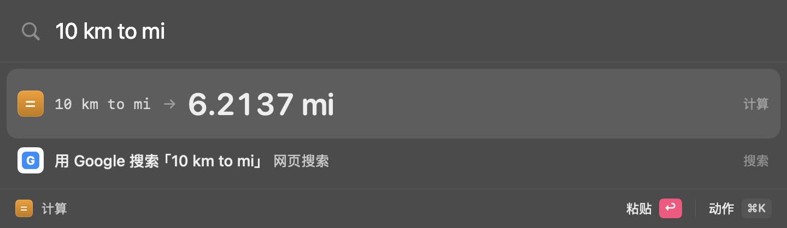
  <br><br>
  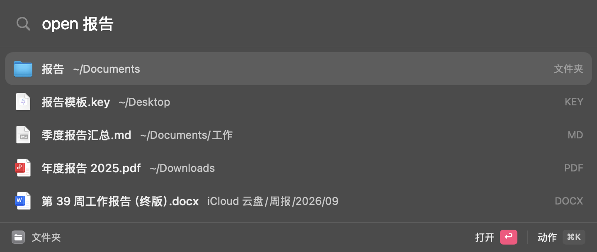
  <br><br>
  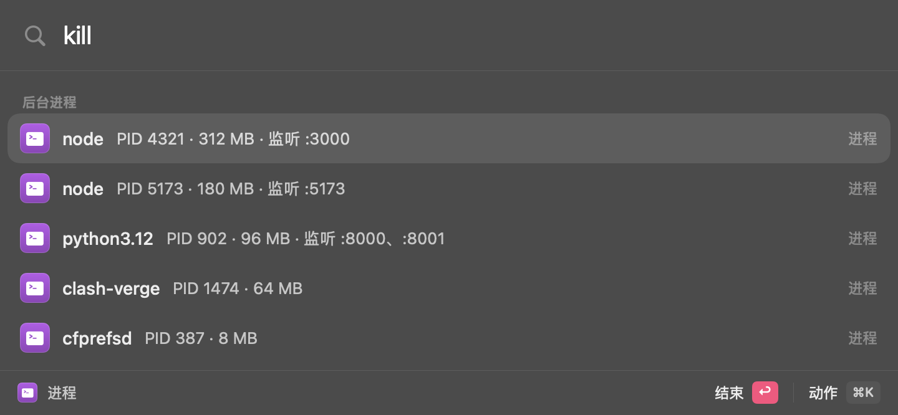
</p>

- **搜 App**：中文名、拼音全拼和首字母都能搜（「huodong」「hdjsq」都能找到活动监视器），按使用频率排序，越用越顺手；⌘D 收藏常用项，空输入时排在最前
- **文件搜索**：`open 文件名` 打开，`find 文件名` 在访达中选中，支持中文和拼音；⌘Y 快速查看，⌘K 用其他 App 打开或移到废纸篓
- **计算器与换算**：四则运算、百分比、乘方、函数；单位换算（`10 km to mi`、`30 摄氏度 转 华氏度`）、进制转换（`255 in hex`），↩ 直接粘贴结果
- **系统命令**：`lock`、`sleep`、`restart`、`emptytrash`、`mute` 等（中文、拼音也行）；`quit` / `hide` / `forcequit` 管理正在运行的 App，`eject` 推出磁盘，`kill` 结束进程或按端口找（`kill :3000`），`port` 看哪些端口被占着、是谁占的（`port 3000`）
- **系统设置直达**：搜「蓝牙」「显示器」「隐私与安全」，↩ 跳到对应的设置页
- **网页搜索**：`g swift`、`gh swift` 这样用关键词直达，预置 Google、Bing、百度、GitHub、知乎、哔哩哔哩等 13 个引擎，可自定义搜索和快捷链接
- **浏览器书签与历史**：Safari、Chrome、Edge、Arc、Brave、Firefox 等，只列本机装了的，带网站图标；输入网址或 `~/` 路径直接打开
- `cb 关键词` 跳到剪贴板历史搜索，`fy 文字` 直接翻译，⌘K 或 → 打开动作菜单

### 🌐 翻译

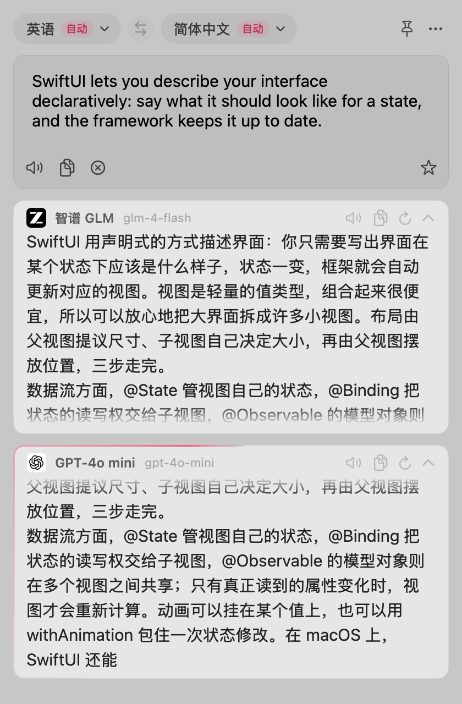

- **划词翻译**：在任意 App 里选中文字按快捷键就翻译，浮窗跟着鼠标出现；取不到选区时自动改用 ⌘C 取词，用完把剪贴板恢复原样
- **输入翻译、复制即译、截图翻译**：框选屏幕上的文字，本机识别后翻译
- **多服务并行**：智谱 GLM（内置，开箱即用）、百度、有道、Google、DeepL / DeepLX、微软（不填密钥也能用）、火山、腾讯，以及 OpenAI / Azure OpenAI / Anthropic 协议的大模型；DeepSeek、Kimi、通义千问、硅基流动、OpenRouter、Gemini、Ollama 等有预设，填好密钥就能用；大模型的译文边生成边显示
- **查词**：单个词显示系统词典释义卡片，大模型按词典格式回答
- **替换原文**：用译文直接替换原 App 里选中的文字，也可以设一个静默热键，一按即替换
- **翻译历史 / 生词本**：可搜索、收藏，导出 CSV 或可直接导入 Anki 的 TSV
- 支持 11 种语言，目标语言选「自动」时在第一 / 第二语言之间互译；支持朗读、自动复制译文

<br clear="right">

### ✂️ 截图

<p align="center">
  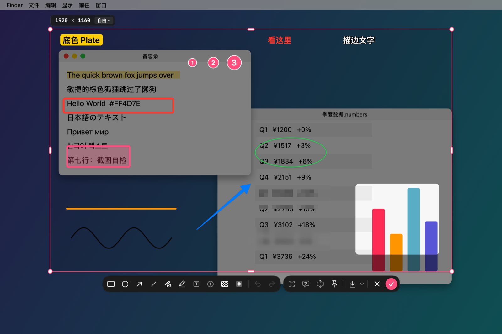
</p>

- **框选**：先冻结屏幕再框选，悬停自动识别窗口，吸附窗口边和屏幕边；尺寸可直接输入，比例可锁定
- **放大镜取色**：按 C 复制光标处的 `#RRGGBB`
- **10 种标注工具**：矩形、椭圆、箭头（可拖成弧线）、直线、画笔、荧光笔、文字、序号、马赛克、聚光灯，用数字键 1–0 切换；标注画完后仍能移动、改大小、复制，支持撤销 / 重做
- **出图**：↩ 拷贝，⌘S 保存 PNG，T 钉在屏幕上当参考（钉图也能识字、翻译、保存），O 识字（也能识别二维码），一键送去翻译
- **长截图**：框选后按 S，在选区里滚动就自动拼接，按空格自动滚动
- **长截图**拼完还能标注，十种工具和截图里的一样
- **截图历史**：截图、长截图、钉过的图、录屏录音和 GIF 都留在一处，按日期排好、能搜能筛；双击一张回到原图上接着改标注，还能重新拷贝、钉回原来的位置
- 截图后缩略图停在屏幕右下角，可以直接拖出成文件；识字、取色等结果从刘海处弹出轻提示

<p align="center">
  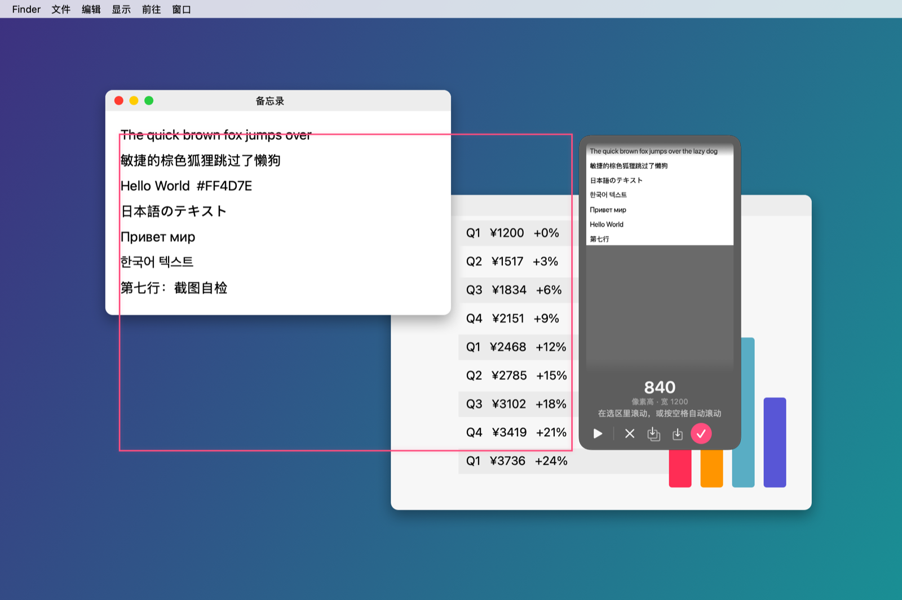
</p>

### 🎬 录屏与录音

- **录屏**：和截图一样框选一块区域或整块屏幕，↩ 开始，默认倒数 3 秒后开录；录系统声音和麦克风，可以显示点按和按下的键；菜单栏计时，再按一次快捷键停止并保存
- **录音**：先出一个控制条，选好来源（麦克风 / 系统声音 / 两者）再开始，电平实时显示，存成 m4a
- 录完的视频卡停在屏幕角落，可以拷贝、拖走、**转成 GIF** 或压缩；帧率、清晰度、H.264 / HEVC 都能在 设置 › 录制 里选

### 🗒️ 便签

<p align="center">
  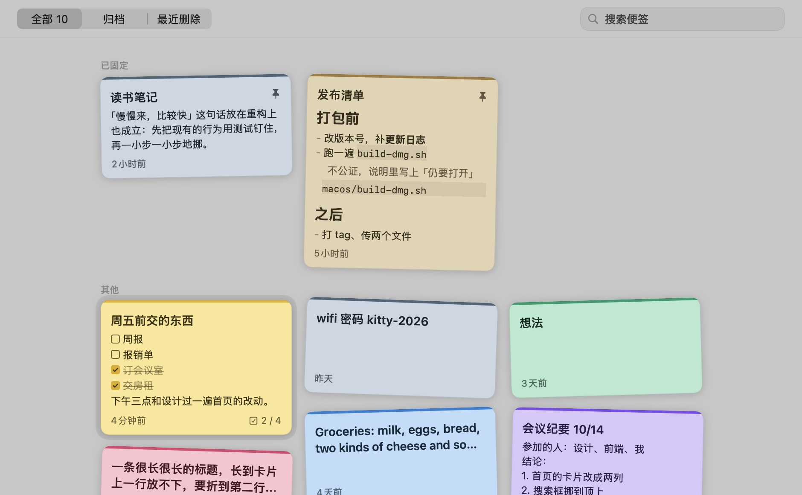
</p>

- **快速记一条**（`⌥N`）：在任何 App 里弹出一个小框，记成新便签，或接在最近改过的某一条后面
- **屏幕边缘的那叠**：药丸贴在屏幕边上，鼠标靠过去扇出标签，点开就写，写完接着回原来的 App
- **全部便签**：便签墙（卡片瀑布流）和列表两种看法，能搜索、归档、固定，删掉的留 30 天能放回
- **浮在屏幕上**：把便签拖出来钉在桌面，固定后一直在别的窗口上面，重启后回到原处
- **正文**：纯文本 + Markdown 样式（标题、列表、引用、代码块、链接），五种任务状态、文字颜色、行内图片（能裁切、选宽度）、便签内查找、撤销重做
- 整个或单条导出成 Markdown，再导回来；和剪贴板、启动器、划词翻译打通；单独的库和每日备份

### 🔲 启动台（macOS 26 起）

- 全屏的 App 图标网格，背景是桌面壁纸糊开的样子：一页一页翻，打开就能直接打字搜（中文名、拼音、首字母都行）
- 拖动排序、拖到一起建文件夹，按住图标进入抖动模式删除从 App Store 装的 App
- 四指 / 五指捏合触控板打开，画面跟着手指走；也可以设一个触发角
- 第一次打开时按系统原来的启动台排好页和文件夹；macOS 15 上不出现（用系统自带的）

### ✋ 状态屏

<p align="center">
  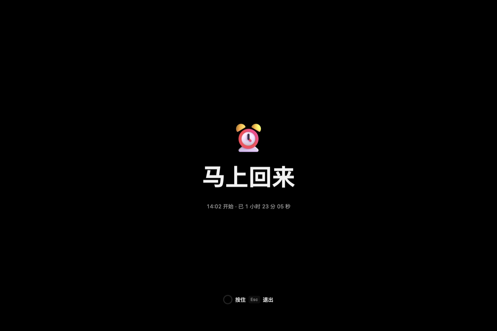
</p>

- 一键把所有屏幕盖上一块告示（自带「清洁屏幕」「请勿触碰」「马上回来」），同时拦住键盘鼠标，擦屏幕、电脑在跑任务不想被人碰、离开座位时用
- 告示的文字、动画表情、样式都能自己改，可以有好几个状态，按快捷键先选一个再进
- 按住 Esc 2 秒（或用鼠标按住屏幕底部的提示）退出，可以再加一道退出密码

### 🪟 程序坞预览（默认关）

<p align="center">
  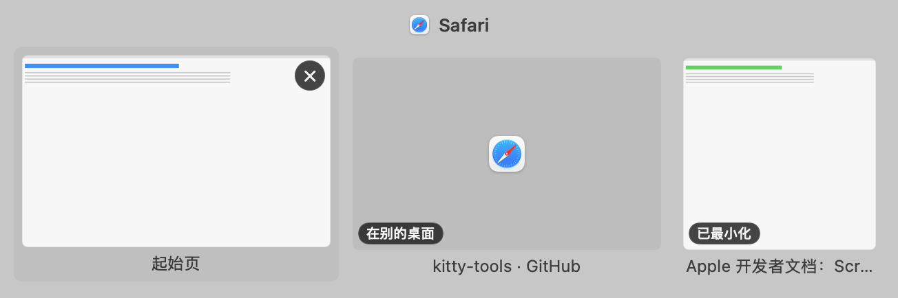
</p>

- 鼠标停在程序坞的 App 图标上，上方弹出它所有窗口的缩略图（最小化的、隐藏的、别的桌面上的也列出来），点一张切过去，悬停点 ✕ 关掉
- 在 设置 › 程序坞预览 里打开；要辅助功能授权，有屏幕录制授权才有缩略图

### 🏝️ 刘海岛

- 复制好了、存好了、出错了这些提示都从刘海里长出来，鼠标挪上去停住、展开看全文和按钮（「在访达中显示」「撤销」「重试」…）
- 点一下刘海叫出最近 10 条提示和一排快捷动作（截图、识字、截图翻译、录屏、录音、快速记一条）；没有刘海的屏幕用快捷键打开

### ⚙️ 设置

<p align="center">
  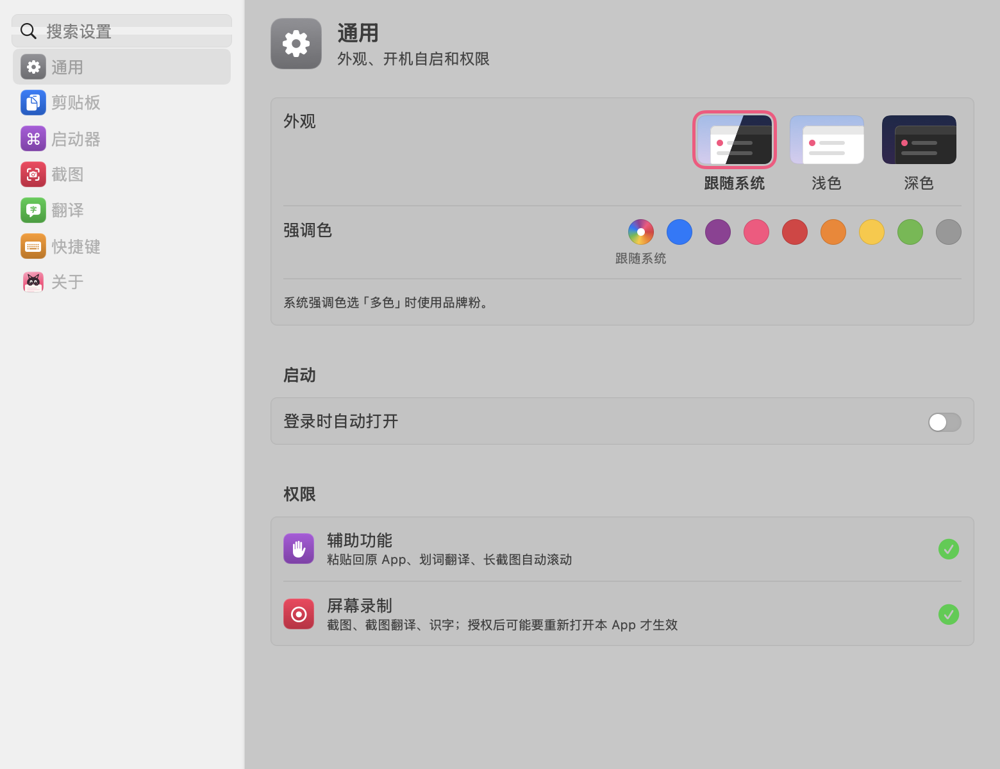
</p>

外观（跟随系统 / 浅色 / 深色）、8 种强调色、开机自启、权限状态、全局快捷键录制都在设置窗里，侧栏可以搜索设置项。菜单栏图标可以换成彩色，也可以整个隐藏（快捷键照常能用）。

- **功能开关**：设置 › 通用 › 功能 里每个功能一个开关，关掉的入口、快捷键、后台活全都停掉，打开立即回来
- **同步**：选一个文件夹（比如 iCloud 云盘），设置与快捷键、片段和收藏、生词本、网页搜索、翻译服务、状态屏的状态、启动器收藏、便签就能在几台 Mac 之间同步，每类一个开关；密钥不同步
- **备份与导出**：每天自动备份一份（留最近 7 份，可以另存到别的文件夹），设置与数据能导出成一个文件再导入（密钥可以加密带上）
- **快捷键速查表**：各设置页的「查看全部快捷键…」，按功能分类、能搜索，从哪一页点开就停在哪一类

## macOS 版的默认快捷键

| 功能 | 快捷键 |
|---|---|
| 剪贴板历史 | `⌥C` |
| 启动器 | `⌥Space` |
| 划词翻译 | `⌥D` |
| 输入翻译 | `⌥T` |
| 截图翻译 | `⌥S` |
| 截图 | `⌥A` |
| 截取上次区域 | `⌥X` |
| 识字（OCR / 二维码） | `⌥O` |
| 录屏 | `⌥R` |
| 快速记一条（便签） | `⌥N` |

划词翻译并替换、录音、截图历史、钉住剪贴板里的图、新建便签、全部便签、启动台、状态屏、打开刘海岛默认不设，需要时到「设置 › 快捷键」里自己录。所有快捷键都能在那里改。macOS 15.0 / 15.1 不允许注册只带 ⌥ 的组合，在这两个版本上请改成带 ⌘ 或 ⌃ 的组合（快捷键页会提示）。

## 安装 macOS 版

1. 从 [Releases](https://github.com/YyAdnBug/kitty-tools/releases/latest) 下载 `Kitty.Tools_x.y.z_arm64.dmg`（`_arm64.zip` 是 App 内更新用的，不用手动下载），或按下面的步骤自己打包。
2. 把 `Kitty Tools.app` 拖进「应用程序」。
3. App 使用 Apple Development 签名、没有公证，第一次打开会被系统拦下（提示「未打开」，不是「已损坏」）：到「系统设置 › 隐私与安全」里点「仍要打开」。也可以在终端执行：
   ```bash
   xattr -dr com.apple.quarantine "/Applications/Kitty Tools.app"
   ```
4. 按首次启动的欢迎引导授权：
   - **辅助功能**：粘贴回原 App、划词翻译、替换原文、长截图自动滚动、录屏显示按键、程序坞预览
   - **屏幕录制**：截图、截图翻译、识字、长截图、录屏、录系统声音、程序坞预览的缩略图（授权后可能需要重新打开 App）
   - **麦克风**：录屏、录音时录下你的声音，第一次用到时才问
   - **文件和文件夹**：只在启动器文件搜索时按需申请
   - **完全磁盘访问权限**（可选）：只在要搜 Safari 书签和历史时需要

只有第一次安装要放行；之后有新版本时菜单栏会出现「更新到 x.y.z…」，一键更新，不用再放行。

> 新装（或系统大版本更新）后的第一次识字，系统要先为本 App 准备识字模型，大约要一分钟。App 启动后会在后台自己准备好；要是赶上还没准备完，刘海岛会说「正在准备识字模型」并显示已等了多久，之后识字都是一眨眼的事。

## 从源码构建 macOS 版

代码在 `macos` 分支。需要 Xcode 26.3 及以上和 Apple 芯片的 Mac，没有任何第三方依赖。

```bash
git clone -b macos https://github.com/YyAdnBug/kitty-tools.git
cd kitty-tools
xcodebuild -project macos/KittyTools.xcodeproj -scheme KittyTools build
```

- **签名**：`macos/Config/Base.xcconfig` 里的 `DEVELOPMENT_TEAM` 改成你自己的 Team ID。
- **内置智谱密钥（可选）**：新建 `macos/Config/Secrets.xcconfig`（已被 `.gitignore` 忽略，不会提交），写入 `ZHIPU_BUILTIN_KEY = 你的智谱 API Key`。不配置也能正常构建，只是智谱翻译需要在设置里自己填密钥。
- **打 DMG**：`macos/build-dmg.sh`，产物在 `macos/build/`。

```bash
# 单元测试
xcodebuild -project macos/KittyTools.xcodeproj -scheme KittyTools test

# 界面截图自检：屏幕外渲染各界面（含深色）为 PNG，本 README 的截图就来自这里
TEST_RUNNER_KITTY_SNAPSHOT_DIR=/tmp/kitty-shots xcodebuild -project macos/KittyTools.xcodeproj -scheme KittyTools \
  test -only-testing:KittyToolsTests/SnapshotProbeTests
```

## 项目结构

`macos` 分支：

```
macos/
├── KittyTools/          # App/ Shell/ Storage/ Clipboard/ Launcher/ Launchpad/ Translate/ Screenshot/ StatusScreen/ Notes/ DockPreview/ Settings/ Resources/
├── KittyToolsTests/     # 单元测试与界面截图自检（Swift Testing）
├── Config/              # xcconfig 构建设置、Info.plist
├── build-dmg.sh         # 打包：archive → 自检 → DMG + App 内更新用的 zip
├── brand-icons.swift    # 用 CoreGraphics 生成 App 图标、菜单栏图标和 DMG 背景
└── status-emoji.swift   # 状态屏的动画表情：动画 PNG 转成包里用的 HEICS
icons/                   # 两个版本共用的功能图标（SVG）和生成脚本
```

开发约定见 `macos` 分支的 [AGENTS.md](https://github.com/YyAdnBug/kitty-tools/blob/macos/AGENTS.md)，各模块规范见 [.cursor/rules/](https://github.com/YyAdnBug/kitty-tools/tree/macos/.cursor/rules)。Windows 版的结构和约定见 `windows` 分支的 [windows/AGENTS.md](https://github.com/YyAdnBug/kitty-tools/blob/windows/windows/AGENTS.md)。

## 致谢

- 便签的交互和数值参考了 [Noty](https://github.com/aimen08/noty)（MIT），代码全部自己重写
- 状态屏的动画表情来自 [Microsoft Fluent Emoji Animated](https://github.com/microsoft/fluentui-emoji-animated)（MIT）
